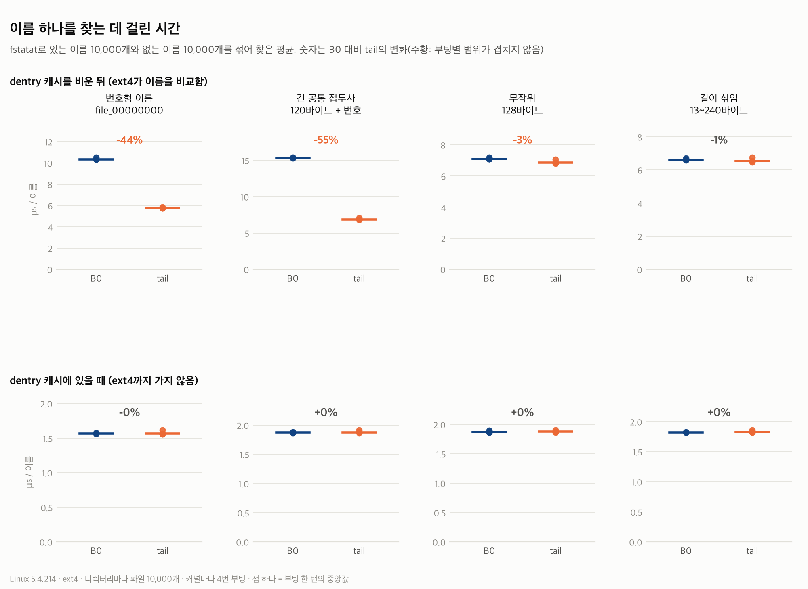
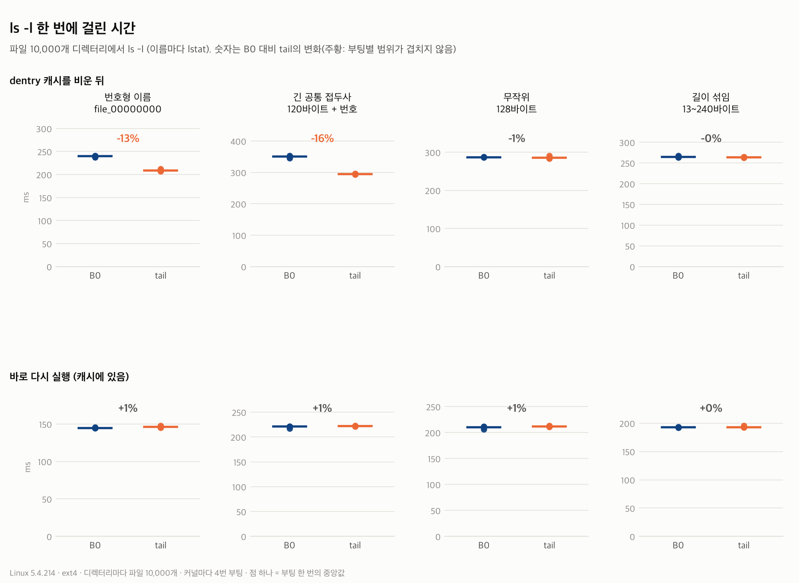

# ext4 디렉터리 이름 비교 개선

중앙대 2026-2 리눅스 시스템 응용 설계 텀프로젝트 8팀 저장소.

ext4에서 파일을 열거나 `stat`할 때 커널은 디렉터리 블록 안의 항목을 하나씩 꺼내 찾는 이름과 비교한다. `file_00000001`, `IMG_0001.jpg`처럼 길이가 같고 앞부분이 같은 이름은 끝 몇 글자만 다른데, 원래 비교는 앞에서부터 한 바이트씩 보기 때문에 거의 끝까지 가서야 다르다는 것을 안다. Linux 5.4.214의 `fs/ext4/namei.c`에 조건문 하나를 더해 이름의 끝 8바이트를 먼저 비교하도록 바꾸고, 원본 커널과 비교해 측정했다.

원본보다 느려진 조건은 없었다. 이름의 앞부분이 같은 디렉터리에서는 이름 하나를 찾는 시간이 44~55% 줄었고, 같은 디렉터리의 `ls -l`은 13~16% 빨라졌다. 이름이 이미 dentry 캐시에 있을 때는 ext4까지 가지 않으므로 차이가 없다.

## 결과 요약

커널마다 4번 부팅해 잰 값이다. 숫자는 부팅 4번 각각의 중앙값을 모아 다시 중앙값을 낸 것이다.

| 디렉터리 | 이름 하나 찾는 시간 (B0 → tail) | `ls -l` 한 번 (B0 → tail) |
|---|---|---|
| 번호형 `file_00000000` | 10.35 → 5.76 µs (**−44%**) | 240 → 209 ms (**−13%**) |
| 긴 공통 접두사 (120바이트 + 번호) | 15.37 → 6.87 µs (**−55%**) | 351 → 295 ms (**−16%**) |
| 무작위 128바이트 | 7.10 → 6.85 µs (**−3.5%**) | 287 → 285 ms (차이 없음) |
| 길이 섞임 (13~240바이트) | 6.61 → 6.53 µs (차이 없음) | 265 → 264 ms (차이 없음) |

dentry 캐시를 비운 직후에 잰 값이다. 굵은 값은 B0 부팅 4번과 tail 부팅 4번의 범위가 겹치지 않고, 같은 시드로 묶은 네 쌍 모두에서 tail이 빨랐던 조건이다. "차이 없음"은 범위가 겹치는 조건이다(−0.3~−1.1%).



- 번호형과 긴 접두사 이름은 길이가 모두 같고 앞부분이 같아서, 원래 비교는 디렉터리 블록의 항목마다 이름을 거의 끝까지 한 바이트씩 비교한다. 패치는 이것을 64비트 비교 한 번으로 거른다. 접두사가 길수록 원래 비교가 길어지므로 효과도 크다.
- 무작위 128바이트 이름도 3.5% 빨라졌다. 원래 비교도 첫 바이트에서 끝나지만, 길이가 같은 항목마다 `memcmp` 함수를 한 번씩 부른다. 패치는 함수를 부르기 전에 거르므로 그 호출이 빠진다. 코드로 본 이유이고, 호출 수를 따로 세지는 않았다.
- 길이가 섞인 디렉터리는 대부분의 항목이 원래 코드의 길이 비교에서 이미 걸러지므로 차이가 거의 없다.
- dentry 캐시에 이름이 있을 때는 네 디렉터리 모두 차이가 0.3% 안이다(아래 그림 두 번째 줄). 이 경로는 ext4를 부르지 않으므로 차이가 없는 것이 맞다.



- `ls -l`은 디렉터리를 읽고, 이름마다 `lstat`하고, 결과를 정렬해 출력한다. 이름 조회는 그중 일부라서 효과가 13~16%로 줄어든다. 바로 다시 실행하면(캐시에 있음) 차이가 1% 안팎이다.
- 전체 수치는 [analysis/summary_change.csv](analysis/summary_change.csv)(커널별 비교와 쌍별 변화율), [analysis/summary_lookup.csv](analysis/summary_lookup.csv), [analysis/summary_ls.csv](analysis/summary_ls.csv)에 있다.

### 읽은 결과가 같은지

- 이름 조회 5,120만 건(세션 8개 × 320회 × 2만 건)에서 있음/없음이 틀린 경우는 0이다. 같은 시드로 묶은 B0와 tail 세션은 라운드마다 결과 해시가 같다.
- `ls -l` 출력 전체의 해시는 디렉터리마다 하나다. 두 커널의 모든 실행에서 같았다.
- 정확성 검사([아래](#정확성))는 두 커널 모두 통과했고, 검사한 내용의 해시도 같다. 매 세션 뒤 테스트 이미지의 `e2fsck -fn`도 깨끗했다.

### 이전 실험과의 관계

이 후보는 [lsa-2026-team8-ext4-explore](https://github.com/noir1458/lsa-2026-team8-ext4-explore)에서 다른 후보 둘과 함께 찾았다. 그때의 실험 커널에는 계측 코드가 같이 들어 있어서 기능을 꺼도 원본보다 3~5% 느렸고, 그래서 원본과 직접 비교하기 어려웠다. 이 저장소는 패치만 넣은 커널을 새로 빌드해 원본과 다시 비교한 것이다.


## 무엇을 바꿨나

`ext4_match()`가 이름 전체를 비교하기 바로 앞에 아래 조건문을 넣었다. 패치 파일은 [patches/ext4-name-tail-compare.patch](patches/ext4-name-tail-compare.patch)다.

```c
if (!IS_ENCRYPTED(parent) && f.disk_name.name &&
    f.disk_name.len == de->name_len && de->name_len >= 8 &&
    memcmp(de->name + de->name_len - 8,
           f.disk_name.name + de->name_len - 8, 8))
        return false;
```

- 길이가 같고 8바이트 이상인 이름만 대상이다. 길이가 다르면 원래 코드도 바로 다르다고 판단한다.
- 끝 8바이트가 다르면 바로 "다른 이름"으로 돌려준다. 끝 8바이트가 같으면 원래대로 이름 전체를 비교하므로, 끝만 같은 다른 이름을 같은 이름으로 착각하지 않는다.
- 8바이트를 고른 이유는 64비트 레지스터 한 칸이기 때문이다. 길이가 8로 고정된 `memcmp`는 64비트 읽기와 비교 한 번으로 컴파일된다(아래 기계어). 이 빌드의 일반 `memcmp`는 한 바이트씩 도는 반복문이다.
- 디스크 형식, HTree 색인, 해시는 바꾸지 않는다. 암호화된 디렉터리와 대소문자 무시(casefold) 디렉터리는 원래 경로를 그대로 쓴다.

컴파일된 `ext4_search_dir()`의 해당 부분:

```
cmp    $0x7,%al                    # 이름 길이가 8 이상인가
jbe    ...
mov    -0x8(%rdi,%rdx,1),%rax      # 디렉터리 항목 이름의 끝 8바이트
cmp    %rax,-0x8(%r10,%rdx,1)      # 찾는 이름의 끝 8바이트와 비교
je     ...                         # 같으면 원래의 전체 비교(memcmp 호출)로
jmpq   ...                         # 다르면 다음 항목으로
```

## 실험 방법

- 커널 두 개를 같은 소스와 같은 설정으로 빌드했다. B0(`5.4.214-b0`)는 원본, tail(`5.4.214-tail`)은 위 패치만 넣은 것이다. 설정 차이는 커널 이름 한 줄이다. tail을 빌드한 소스는 패치를 넣기 전에 kernel.org tarball의 파일 65,708개와 모두 같은지 확인했다.
- 테스트 이미지는 128 MiB ext4 이미지 파일 하나이고, 디렉터리 네 개에 빈 파일을 10,000개씩 만들었다. 네 디렉터리 모두 HTree 색인이 켜져 있다.

| 디렉터리 | 이름 예 | 의미 |
|---|---|---|
| short13 | `file_00000000` | 번호형 이름. 앞 5글자가 모두 같다 |
| long128 | `ppp…ppp00000000` (120바이트 + 8자리 번호) | 공통 접두사가 아주 긴 경우 |
| random128 | 무작위 128바이트 | 앞에서부터 바로 다른 이름 |
| varied | 길이 13~240바이트, 무작위 앞부분 + 8자리 번호 | 길이가 섞인 경우 |

- 이름 조회: `bench/lookup_bench`가 있는 이름 10,000개와 없는 이름 10,000개를 섞은 순서로 `fstatat`한다. 질의 하나당 평균 시간을 본다. 결과(있음/없음)가 하나라도 틀리면 실패로 처리한다.
  - dentry 캐시를 비운 뒤(`drop_caches=2`): 이름마다 ext4가 디렉터리 블록에서 이름을 비교한다. 디렉터리 블록은 페이지 캐시에 남아 있으므로 디스크 읽기는 없다.
  - dentry 캐시에 있을 때: 같은 이름을 한 번 찾아 둔 뒤 다시 찾는다. 이때는 ext4까지 가지 않으므로 차이가 없어야 한다.
- 실제 명령: 같은 디렉터리에서 `ls -l`(이름마다 `lstat`)을 dentry 캐시를 비운 직후와 바로 다시 한 번 실행해 시간을 쟀다. 출력 전체의 해시가 두 커널에서 같은지도 확인했다.
- 커널마다 4번씩 B0 → tail → tail → B0 → B0 → tail → tail → B0 순서로 부팅했다. 부팅 후 4분이 지나고 부하가 0.6 아래로 떨어진 뒤 시작한다. 부팅 한 번에 이름 조회는 조건마다 40회(20라운드 × 2회), `ls -l`은 20회 쟀다. 측정 프로세스는 CPU 0에 고정했다.
- 커널은 따로 부팅해서 쟀으므로 부팅 한 번의 중앙값을 점 하나로 보고 비교한다.

## 정확성

각 커널의 첫 부팅에서 새 64 MiB 이미지에 [scripts/check_correctness.py](scripts/check_correctness.py)를 돌렸다.

- 색인된 디렉터리 두 개(각 1,200개 이상)에서 이름 바꾸기, 하드 링크, 원래 이름 지우기, 다른 디렉터리로 옮기기, 덮어쓰기, 지운 뒤 다시 만들기를 하고, 단계마다 dentry 캐시를 비운 뒤 모든 이름의 inode, 링크 수, 크기, 내용을 확인한다.
- 이 패치가 헷갈리면 안 되는 이름을 따로 넣었다. 끝 8바이트와 길이가 같고 앞이 다른 쌍(`aaaa_00000001`과 `bbbb_00000001`, 128바이트 쌍), 정확히 8바이트인 이름, 7바이트인 이름, 그리고 있는 이름과 끝이 같지만 없는 이름(`cccc_00000001` 등)이다.
- 검사가 끝나면 이미지에 `e2fsck -fn`을 돌린다.

## 저장소 구조

```
patches/   커널 패치 (이것이 제출하는 변경의 전부다)
bench/     이름 조회 벤치마크 (C)
scripts/   테스트 이미지 만들기, 정확성 검사, 부팅 한 번 분량의 측정
results/   원자료 (부팅별 세션, 빌드 기록)
analysis/  요약표와 그림을 만드는 스크립트
```

## 재현 방법

### 1. 커널 두 개 빌드

kernel.org의 `linux-5.4.214.tar.xz`를 풀고, [results/build/config-5.4.214-b0](results/build/config-5.4.214-b0)를 `.config`로 써서 B0를 빌드한다. 같은 소스에 패치를 넣고 이름만 바꿔 tail을 빌드한다.

```bash
cd linux-5.4.214
cp /path/to/this/repo/results/build/config-5.4.214-b0 .config
make olddefconfig && make -j"$(nproc)"
sudo make modules_install INSTALL_MOD_STRIP=1 && sudo make install
```

```bash
patch -p1 < /path/to/this/repo/patches/ext4-name-tail-compare.patch
scripts/config --set-str LOCALVERSION "-tail"
make olddefconfig && make -j"$(nproc)"
sudo make modules_install INSTALL_MOD_STRIP=1 && sudo make install
```

GRUB 기본 항목은 바꾸지 않고, 측정할 커널은 `grub-reboot`으로 한 번씩만 부팅한다.

```bash
sudo grub-reboot "gnulinux-advanced-<UUID>>gnulinux-5.4.214-tail-advanced-<UUID>"
sudo reboot
```

### 2. 테스트 이미지 (한 번만)

```bash
make -C bench
sudo bash scripts/make_fixture.sh "$PWD"
```

새 이미지 파일 `fixtures/leaf.img`를 만들고 그 안에만 파일을 만든다. 실제 디스크는 포맷하지 않는다.

### 3. 부팅마다 측정

부팅한 커널 이름, 세션 이름, 시드를 준다. 한 쌍(B0와 tail)에는 같은 시드를 쓴다. 각 커널의 첫 세션에는 `check`를 붙여 정확성 검사를 같이 돌린다.

```bash
sudo bash scripts/run_session.sh "$PWD" 5.4.214-b0 s1-b0 101 check
```

결과는 `results/sessions/<세션>/`에 저장된다.

### 4. 요약과 그림

```bash
python3 analysis/analyze.py
```

matplotlib이 필요하다.

## 한계

- 효과는 이름이 dentry 캐시에 없을 때만 있다. 부팅 직후, 메모리가 부족해 캐시가 밀려났을 때, 큰 디렉터리를 처음 훑을 때(`ls -l`, `find`, 백업 프로그램)다. 이미 찾아 본 이름은 ext4까지 가지 않는다.
- 이름 모양에 따라 다르다. 길이가 같고 끝부분이 다른 이름(번호를 붙인 이름)에서 크고, 길이가 다양한 디렉터리에서는 거의 없다.
- 길이와 끝 8바이트가 같고 앞부분이 다른 이름이 많은 디렉터리(예: `2023_report.pdf`, `2024_report.pdf`)는 재지 않았다. 이때는 끝 8바이트 비교가 거르지 못하고 원래 비교가 이어지므로, 비교가 한 번 늘어난다.
- 빈 파일로 만든 합성 디렉터리와 `ls -l`만 쟀다. 실제 사진·로그 폴더나 다른 프로그램에서는 재지 않았다.
- 디렉터리 블록이 페이지 캐시에 있는 상태(디스크 읽기 없음)에서 쟀다. 디스크에서 읽어야 하는 경우에는 차이가 디스크 시간에 묻힐 것이다.
- `memcmp` 자체를 워드 단위로 빠르게 바꾸는 방법과는 비교하지 않았다.
- VirtualBox VM(CPU 2개)에서 잰 값이다. 네 번째 쌍(s4)은 두 커널 모두 다른 쌍보다 1~2% 느렸는데, 측정 중 VM 화면을 원격으로 열어 본 쌍이다. 그래도 이 쌍에서도 변화 방향은 같다.
