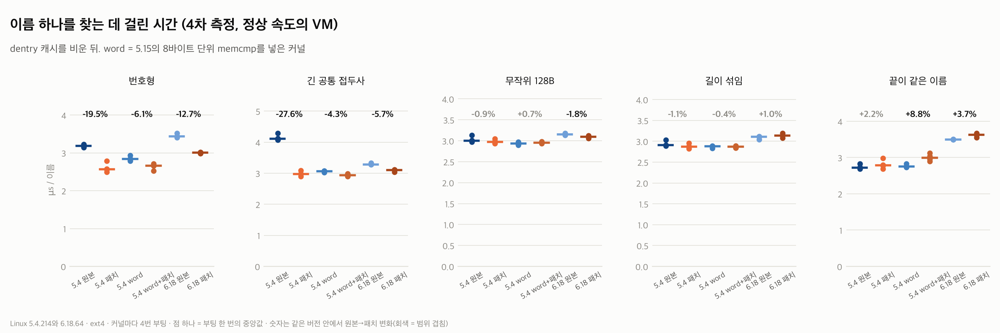
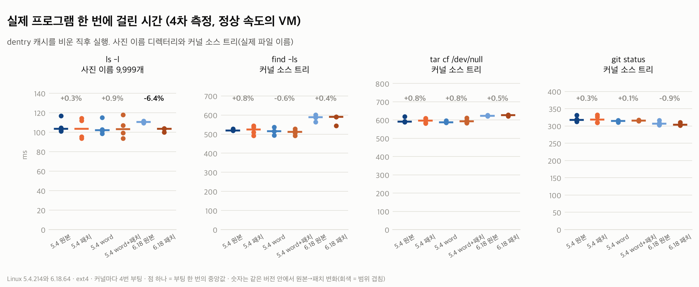
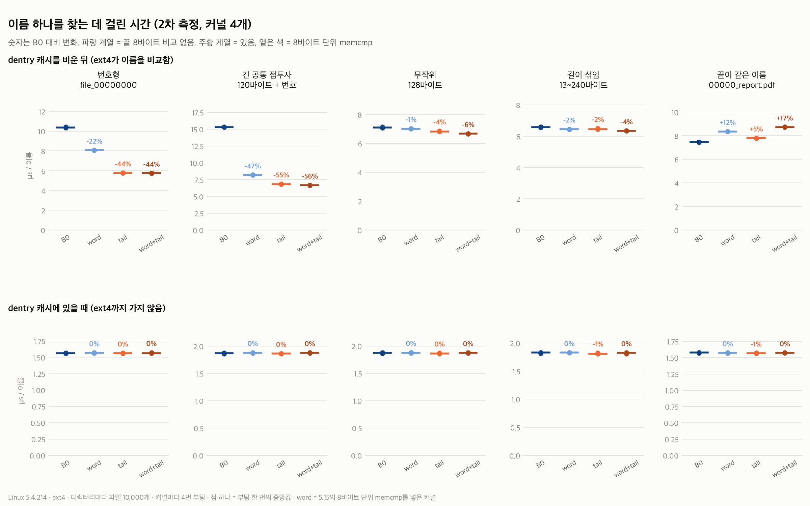
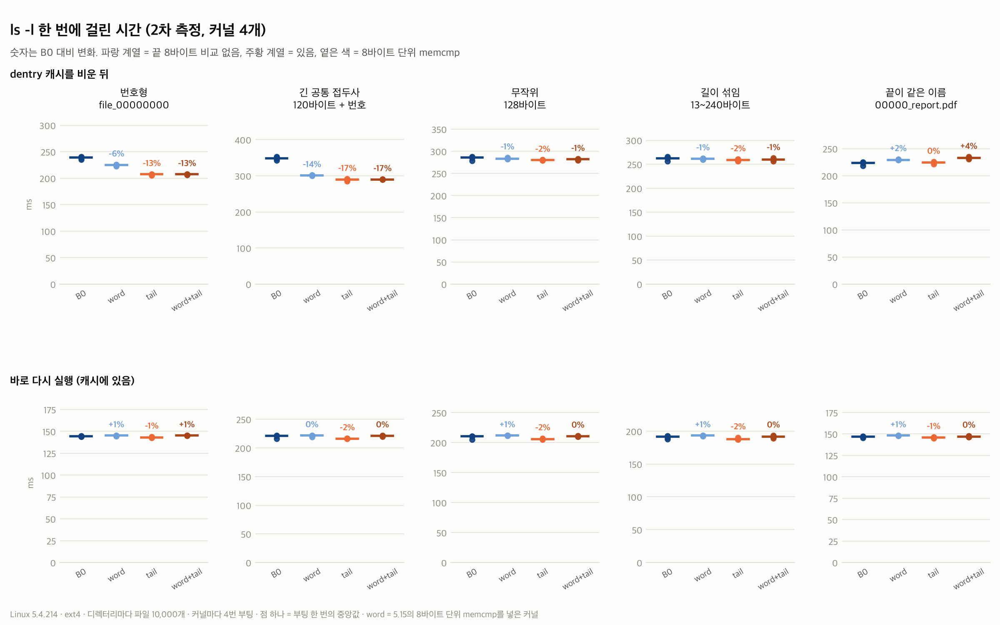
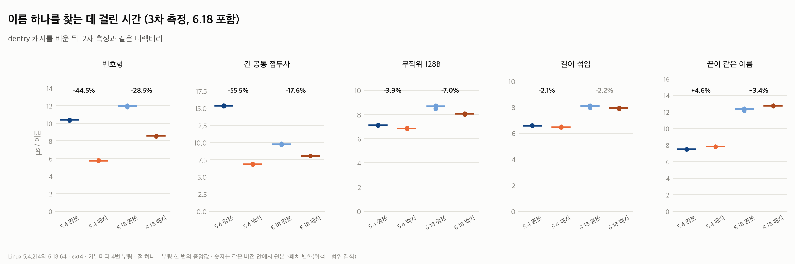
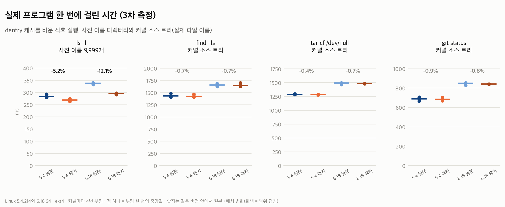

# ext4 디렉터리 이름 비교 개선

중앙대 2026-2 리눅스 시스템 응용 설계 텀프로젝트 8팀 저장소.

ext4에서 파일을 열거나 `stat`할 때 커널은 디렉터리 블록 안의 항목을 하나씩 꺼내 찾는 이름과 비교한다. `file_00000001`, `IMG_0001.jpg`처럼 길이가 같고 앞부분이 같은 이름은 끝 몇 글자만 다른데, 원래 비교는 앞에서부터 한 바이트씩 보기 때문에 거의 끝까지 가서야 다르다는 것을 안다. Linux 5.4.214의 `fs/ext4/namei.c`에 조건문 하나를 더해 이름의 끝 8바이트를 먼저 비교하도록 바꾸고, 원본 커널과 비교해 측정했다.

이름의 앞부분이 같은 디렉터리에서는 이름 하나를 찾는 시간이 20~28% 줄었고(번호형 −19.5%, 긴 접두사 −27.6%), 같은 디렉터리의 `ls -l`은 5~6% 빨라졌다. 손해가 나는 조건도 있다. 모든 이름의 길이와 끝 8바이트가 같고 앞부분만 다른 디렉터리(`00000_report.pdf`, `00001_report.pdf`, …)에서는 없는 이름을 찾을 때 5.1% 느려졌다(있는 이름까지 합친 이름 조회는 +2.2%, 범위 겹침). 이 디렉터리의 `ls -l`에서는 차이가 보이지 않았다. 이름이 이미 dentry 캐시에 있을 때는 ext4까지 가지 않으므로 차이가 없다.

"`memcmp`를 빠르게 하면 되지 않나"도 쟀다. Linux 5.15부터 쓰는 8바이트 단위 `memcmp`를 넣은 커널은 같은 디렉터리에서 11~25% 빨라졌다. 번호형에서는 이 패치가 더 빨랐고(−19.5% 대 −11.1%), 긴 접두사에서는 비슷했다(−27.6% 대 −25.3%). 둘을 합쳐도 이 패치만 넣은 것보다 나아지지 않았다(번호형 −16.5%, 긴 접두사 −28.6%, 끝이 같은 이름 +10.0%).

최신 장기 지원 커널 Linux 6.18.64에도 같은 조건문을 넣어 쟀다. 6.18의 `memcmp`는 이미 8바이트씩 비교하는데, 그 위에서도 번호형 이름 조회가 12.7%, 긴 접두사가 5.7% 줄었고 끝이 같은 이름은 3.7% 느려졌다. 실제 프로그램으로는 카메라처럼 번호를 붙인 사진 이름 9,999개 폴더의 `ls -l`이 6.18에서 6.4% 빨라졌고, 5.4에서는 실행마다 흔들림이 커서 차이를 확인하지 못했다. 파일 이름의 길이가 제각각인 커널 소스 트리에서는 `find`, `tar`, `git status` 모두 차이가 보이지 않았다. ftrace 함수 프로파일러로 보면 번호형·긴 접두사 이름과 사진 이름에서 `ext4_lookup()`이 줄인 시간의 84~99%가 디렉터리 블록 안에서 이름을 비교하는 `ext4_search_dir()`에서 줄었다.

이 숫자는 2026-11-25에 커널 6개를 다시 잰 [4차 측정](#4차-측정-커널-6개를-다시-재기)의 값이다. 1~3차는 같은 VM이 지금보다 약 3배 느린 상태에서 쟀고, 그때는 효과가 더 크게 나왔다(번호형 −44%, 긴 접두사 −55%). 번호형과 긴 접두사가 빨라지는 방향은 네 번 모두 같다. 다시 잰 이유는 [VM 속도와 다시 잰 이유](#vm-속도와-다시-잰-이유)에 있다.

## 결과 요약

4차 측정, 커널마다 4번 부팅해 잰 값이다. 숫자는 부팅 4번 각각의 중앙값을 모아 다시 중앙값을 낸 것이고, dentry 캐시를 비운 직후에 쟀다.

| 디렉터리 | 이름 하나 찾는 시간 (원본 → 패치) | `ls -l` 한 번 (원본 → 패치) |
|---|---|---|
| 번호형 `file_00000000` | 3.19 → 2.57 µs (**−19.5%**) | 85.5 → 81.4 ms (**−4.8%**) |
| 긴 공통 접두사 (120바이트 + 번호) | 4.11 → 2.97 µs (**−27.6%**) | 106.9 → 100.6 ms (**−5.9%**) |
| 무작위 128바이트 | 3.00 → 2.97 µs (−0.9%, 겹침) | 99.5 → 99.0 ms (−0.5%, 겹침) |
| 길이 섞임 (13~240바이트) | 2.90 → 2.87 µs (−1.1%, 겹침) | 95.6 → 94.9 ms (−0.8%, 겹침) |
| 끝이 같은 이름 `00000_report.pdf` | 2.72 → 2.79 µs (+2.2%, 겹침) | 83.8 → 84.3 ms (+0.6%, 겹침) |

굵은 값은 원본 부팅 4번과 패치 부팅 4번의 범위가 겹치지 않고, 같은 시드로 묶은 네 블록 모두에서 방향이 같았던 조건이다. "겹침"은 두 범위가 겹치는 조건이라 차이가 있다고 하지 않는다.



- 번호형과 긴 접두사 이름은 길이가 모두 같고 앞부분이 같아서, 원래 비교는 디렉터리 블록의 항목마다 이름을 거의 끝까지 한 바이트씩 비교한다. 패치는 이것을 64비트 비교 한 번으로 거른다. 접두사가 길수록 원래 비교가 길어지므로 효과도 크다.
- 무작위 128바이트와 길이 섞임은 원래 비교도 금방 끝나서 차이가 보이지 않는다.
- `ls -l`은 디렉터리를 읽고, 이름마다 `lstat`하고, 결과를 정렬해 출력한다. 이름 조회는 그중 일부라서 효과가 5~6%로 줄어든다. 바로 다시 실행하면(캐시에 있음) 차이가 1% 안이다.

## VM 속도와 다시 잰 이유

2026-11-25에 calclock 측정을 준비하다가, 같은 커널(B0)·같은 이미지·같은 절차로 이름 조회가 1~3차보다 3배쯤 빠르게 나오는 것을 발견했다(번호형 10.4 → 3.2 µs, dentry 캐시에 있을 때도 1.56 → 0.97 µs).

- **측정 방법이 달라진 것이 아니다.** 원본 ext4와 pxt4 모듈이 모두 빨라졌고, `lscpu` 출력도 같다. 측정 밖에서 쓴 시간(파이썬, gzip)도 3차 첫 세션의 시행당 0.38초에서 0.15초로 줄었으니, ext4만이 아니라 VM 전체가 느렸다.
- **VM을 새로 켜지 않고 바뀌었다.** 커널 로그의 초기 부팅 시각("Freeing SMP alternatives")은 2·3차의 5.4 커널 부팅이 모두 0.24~0.25초인데, 4차의 5.4 커널 부팅은 모두 0.07~0.08초다(6.18은 0.23초와 0.10초). 과제용 커널은 2026-11-25 14:26에 0.32초, VM 전원을 끄지 않고 15:02에 다시 부팅했을 때 0.16초였다.
- **지금이 이 CPU의 정상 속도로 보인다.** 사용자 공간의 바이트 단위 비교가 지금은 120바이트에 57~58 ns(바이트당 0.5 ns, 2클럭 안쪽)다. 1~3차에서 줄어든 시간으로 역산한 값은 바이트당 약 4 ns다.
- **원인은 찾지 못했다.** 남아 있는 VirtualBox 로그(2026-11-23 저녁 이후)에서 버전(7.2.16), 실행 방식(VT-x), CPU 제한은 모두 같고, 설정 차이는 나중에 붙인 디스크 하나뿐이다. 1~3차 때의 로그는 남아 있지 않다. 호스트(윈도우) 쪽에서 CPU를 느리게 만들던 무언가가 풀린 것으로 추정한다.

역산한 값대로라면 1~3차에는 바이트 단위 반복문이 특히 느렸고, 그 반복을 건너뛰는 이 패치의 효과가 크게 나온 것으로 본다. 그래서 지금 속도에서 모든 비교를 다시 쟀고, 세션마다 VM 속도를 네 번씩 적어([bench/cpu_state.c](bench/cpu_state.c), [summary_round4_state.csv](analysis/summary_round4_state.csv)) 측정하는 동안 속도가 바뀌지 않았는지 확인했다. 1~3차의 숫자는 그 상태의 VM에서 잰 값으로 아래에 그대로 남겨 둔다.

## 4차 측정: 커널 6개를 다시 재기

1~3차에 나눠 비교한 커널 6개를 한 번에 쟀다. 5.4.214 원본(B0), 5.15의 `memcmp`만 넣은 것(word), 이 패치만 넣은 것(tail), 둘 다 넣은 것(word+패치), 6.18.64 원본과 이 패치를 넣은 것이다. 모두 1~3차와 같은 설치본이다.

이름 하나 찾는 시간(µs, dentry 캐시를 비운 뒤). 5.4의 괄호는 5.4 원본 대비 변화이고, "겹침"은 두 커널의 부팅 4번 범위가 겹친다는 뜻이다.

| 디렉터리 | 5.4 원본 | word | 패치 | word+패치 | 6.18 원본 → 패치 |
|---|---|---|---|---|---|
| 번호형 | 3.19 | 2.83 (−11.1%) | 2.57 (−19.5%) | 2.66 (−16.5%) | 3.44 → 3.00 (−12.7%) |
| 긴 공통 접두사 | 4.11 | 3.07 (−25.3%) | 2.97 (−27.6%) | 2.93 (−28.6%) | 3.29 → 3.10 (−5.7%) |
| 무작위 128바이트 | 3.00 | 2.94 (−2.2%) | 2.97 (−0.9%, 겹침) | 2.96 (−1.5%, 겹침) | 3.15 → 3.10 (−1.8%) |
| 길이 섞임 | 2.90 | 2.88 (−0.9%) | 2.87 (−1.1%, 겹침) | 2.87 (−1.3%, 겹침) | 3.11 → 3.14 (+1.0%, 겹침) |
| 끝이 같은 이름 | 2.72 | 2.75 (+1.1%, 겹침) | 2.79 (+2.2%, 겹침) | 3.00 (+10.0%) | 3.50 → 3.63 (+3.7%) |

- **번호형에서는 이 패치가 5.15의 `memcmp`보다 빠르고**(−19.5% 대 −11.1%, 부팅 범위가 겹치지 않지만 틈은 0.005 µs), **긴 접두사에서는 비슷하다**(−27.6% 대 −25.3%, 범위 겹침). `ls -l`은 번호형 −4.8% 대 −3.9%, 긴 접두사 −5.9% 대 −6.8%로 두 방법이 비슷하다. word는 항목마다 `memcmp` 함수를 부르고 같은 앞부분을 8바이트씩 지나가야 하지만, 패치는 함수를 부르기 전에 끝 8바이트 비교 한 번으로 거른다.
- **둘을 합쳐도 패치만 넣은 것보다 나아지지 않는다.** 번호형은 2.57 대 2.66 µs, 긴 접두사는 2.97 대 2.93 µs로 부팅 범위가 겹친다. word 위에 패치를 더한 효과는 번호형 −6.1%, 긴 접두사 −4.3%이지만, 끝이 같은 이름에서는 +8.8%다.
- **6.18.64에서도 번호형 −12.7%, 긴 접두사 −5.7%다.** 6.18의 `memcmp`는 이미 8바이트씩 비교하므로 긴 접두사의 효과가 작다. 5.4와 6.18의 절대값은 설정이 달라 비교하지 않는다.
- **끝이 같은 이름의 손해**는 없는 이름에서 나온다. 5.4는 없는 이름 +5.1%, 6.18은 +5.0%다. 있는 이름은 5.4 +0.7%, 6.18 +1.9%다. 블록의 모든 항목과 비교하는 없는 이름에서 8바이트 비교가 하나씩 늘어나기 때문이다.

있는 이름과 없는 이름으로 나누면(µs, 부팅별 중앙값의 중앙값):

| 디렉터리 | 있는 이름 (5.4 원본 → 패치) | 없는 이름 (5.4 원본 → 패치) | 없는 이름 (6.18 원본 → 패치) |
|---|---|---|---|
| 번호형 | 3.19 → 2.73 (**−14.5%**) | 2.56 → 1.88 (**−26.3%**) | 2.88 → 2.35 (**−18.3%**) |
| 긴 공통 접두사 | 3.98 → 3.18 (**−20.2%**) | 3.65 → 2.17 (**−40.7%**) | 2.55 → 2.26 (**−11.4%**) |
| 무작위 128바이트 | 3.20 → 3.19 (−0.2%, 겹침) | 2.18 → 2.16 (−1.3%, 겹침) | 2.33 → 2.27 (**−2.6%**) |
| 길이 섞임 | 3.10 → 3.06 (−1.0%, 겹침) | 2.09 → 2.08 (−0.6%, 겹침) | 2.29 → 2.28 (−0.2%, 겹침) |
| 끝이 같은 이름 | 2.93 → 2.95 (+0.7%, 겹침) | 1.97 → 2.07 (**+5.1%**) | 2.92 → 3.07 (**+5.0%**) |

없는 이름에서 효과가 더 크다. 없는 이름은 블록의 모든 항목과 비교해야 하고, 있는 이름은 찾으면 멈춘 뒤 inode를 불러오는 시간이 더해지기 때문이다.

`ls -l` 한 번(ms, dentry 캐시를 비운 직후):

| 디렉터리 | 5.4 원본 | word | 패치 | word+패치 | 6.18 원본 → 패치 |
|---|---|---|---|---|---|
| 번호형 | 85.5 | 82.2 (−3.9%) | 81.4 (−4.8%) | 79.2 (−7.3%) | 83.6 → 80.9 (−3.2%, 겹침) |
| 긴 공통 접두사 | 106.9 | 99.7 (−6.8%) | 100.6 (−5.9%) | 96.6 (−9.7%) | 95.4 → 95.8 (+0.4%, 겹침) |
| 무작위 128바이트 | 99.5 | 95.8 (−3.7%) | 99.0 (−0.5%, 겹침) | 96.6 (−3.0%, 겹침) | 92.8 → 95.2 (+2.6%, 겹침) |
| 길이 섞임 | 95.6 | 93.4 (−2.4%) | 94.9 (−0.8%, 겹침) | 91.9 (−3.9%) | 89.8 → 90.8 (+1.1%, 겹침) |
| 끝이 같은 이름 | 83.8 | 82.7 (−1.3%, 겹침) | 84.3 (+0.6%, 겹침) | 83.1 (−0.8%, 겹침) | 84.0 → 85.6 (+1.9%, 겹침) |

- 5.4에서 이 패치는 번호형 −4.8%, 긴 접두사 −5.9%였고 나머지는 겹친다. 6.18은 모두 겹친다(번호형 −3.2%).
- word 커널은 이름이 캐시에 있을 때의 `ls -l`도 1~2% 빨랐다(겹치지 않은 조건 세 개). 이름 비교와 상관없는 경로이므로, word가 든 커널의 `ls -l`에는 이만큼의 다른 차이가 섞여 있다.

실제 프로그램 한 번(dentry 캐시를 비운 직후):

| 작업 | 5.4 원본 → 패치 | 6.18 원본 → 패치 |
|---|---|---|
| `ls -l`, 사진 이름 9,999개 | 103.4 → 103.6 ms (+0.3%, 겹침) | 110.6 → 103.6 ms (**−6.4%**) |
| `find -ls`, 커널 소스 트리 | 519.7 → 523.7 ms (+0.8%, 겹침) | 588.1 → 590.3 ms (+0.4%, 겹침) |
| `tar cf /dev/null`, 커널 소스 트리 | 591.5 → 596.1 ms (+0.8%, 겹침) | 623.1 → 626.5 ms (+0.5%, 겹침) |
| `git status`, 커널 소스 트리 | 317.5 → 318.5 ms (+0.3%, 겹침) | 306.5 → 303.8 ms (−0.9%, 겹침) |



- 사진 폴더의 `ls -l`은 6.18에서 네 블록 모두 빨랐다. 5.4는 같은 부팅 안에서도 91~154 ms로 흔들려 블록별 변화가 −18~+12%였고, 있을 수 있는 차이를 가려내지 못했다. 프로파일로 보면 5.4에서 줄어든 시간은 이름 하나에 0.3 µs, 만 개에 약 3 ms(약 3%)다.
- 커널 소스 트리에서는 차이가 보이지 않았다. 파일 이름의 길이가 대부분 달라 원래 코드의 길이 비교에서 이미 걸러진다([실제 디렉터리의 이름 모양](#실제-디렉터리의-이름-모양)).

비교 시간의 직접 측정(ftrace 함수 프로파일러, 커널마다 12번 실행의 중앙값):

| 작업 | 호출 수 | `ext4_search_dir()` 한 번 (µs), 5.4 원본 → 패치 | 6.18 원본 → 패치 | `ext4_lookup()`이 준 시간 중 `ext4_search_dir()`의 몫 (5.4 / 6.18) |
|---|---|---|---|---|
| 이름 조회, 번호형 | 20,021 | 0.87 → 0.34 | 0.98 → 0.55 | 94% / 99% |
| 이름 조회, 긴 공통 접두사 | 20,021 | 1.28 → 0.27 | 0.42 → 0.22 | 94% / 91% |
| 이름 조회, 무작위 128바이트 | 20,021 | 0.27 → 0.26 | 0.28 → 0.23 | — / — |
| 이름 조회, 길이 섞임 | 20,021 | 0.28 → 0.28 | 0.33 → 0.32 | — / — |
| 이름 조회, 끝이 같은 이름 | 20,021 | 0.47 → 0.54 | 1.03 → 1.13 | — / — |
| `ls -l`, 사진 이름 | 10,034 | 0.60 → 0.32 | 1.03 → 0.50 | 84% / 94% |
| `find -ls`, 커널 소스 트리 | 70,124 | 0.22 → 0.22 | 0.37 → 0.37 | — / — |

- 호출 수는 원본과 패치가 같다. 패치는 찾아보는 블록 수를 바꾸지 않고 블록 하나를 비교하는 시간을 줄인다.
- 번호형, 긴 접두사, 사진 이름에서 `ext4_lookup()` 한 번에서 준 시간의 84~99%가 `ext4_search_dir()` 안에서 줄었다. 끝이 같은 이름에서는 5.4에서 15%, 6.18에서 10% 늘었다.
- 프로파일러는 추적하는 호출마다 시간을 더하므로 절대값은 실제보다 크다. 같은 버전 안에서 원본과 패치를 비교하는 데만 쓴다.

**방법.** 3차와 다른 점만 적는다.

- 부팅 순서: 커널 6개의 6×6 Williams 배열에서 앞의 네 행을 블록 네 개로 썼다. 커널마다 4번, 모두 24번 부팅했고 한 블록의 여섯 세션은 같은 시드를 쓴다.
- 속도 확인: 세션마다 시작할 때, 이름 조회 뒤, `ls -l` 뒤, 끝날 때 `bench/cpu_state`를 돌렸다. 24개 세션의 96번이 모두 56.8~58.0 ns(120바이트 비교 한 번)였고, 느려서 다시 잰 세션은 없다.
- 이름 조회, `ls -l`, 실제 프로그램, 프로파일의 절차와 반복 횟수는 3차와 같다.
- 대조 조건: dentry 캐시에 있을 때 이름 조회는 모든 비교에서 차이가 1% 안이고 범위가 겹친다.
- 정확성: 여섯 커널 모두 첫 부팅에서 정확성 검사를 통과했다. 이름 조회 9,600만 건에서 틀린 경우는 0이고, `ls -l`과 실제 프로그램의 출력 해시는 각각 하나로 모든 세션에서 같았다. 두 이미지 모두 `e2fsck -fn`을 통과했다.
- 수치는 [analysis/summary_round4_change.csv](analysis/summary_round4_change.csv)와 [analysis/summary_round4_profile.csv](analysis/summary_round4_profile.csv), 원자료는 [results/round4/](results/round4/)에 있다.

## calclock으로 본 비교 횟수와 시간

수업 실습에서 쓴 pxt4 방식(ext4를 이름만 바꾼 모듈로 복사해 계측)으로, 패치가 하는 일을 직접 셌다. 원본 모듈과 패치를 넣은 모듈을 같은 커널(`5.4.214-b0`)에서 번갈아 올려 쟀으므로 측정 중에 재부팅이 없다. `search_dir`과 `lookup`의 시간은 수업 도구 calclock으로(20번), 항목이 어디서 갈리는지는 ds_monitoring으로(2번) 쟀다. 4차와 같은 속도의 VM에서 2026-11-25에 쟀다. 작동 원리를 보이는 보조 자료이고, 패치의 효과는 위의 커널 측정을 기준으로 한다.

| 작업 | `search_dir` 한 번 (ns, 원본 → 패치) | `lookup` 한 번 (ns, 원본 → 패치) | 이름 전체를 비교한 항목 수 (원본 → 패치) |
|---|---|---|---|
| 이름 조회, 번호형 | 824 → 299 (−63.7%) | 1957 → 1426 (−27.1%, 겹침) | 1,899,611 → 10,002 |
| 이름 조회, 긴 공통 접두사 | 1246 → 236 (−81.1%) | 2724 → 1672 (−38.6%) | 334,569 → 10,003 |
| 이름 조회, 무작위 128바이트 | 232 → 237 (+1.9%, 겹침) | 1680 → 1691 (+0.7%, 겹침) | 335,273 → 10,002 |
| 이름 조회, 길이 섞임 | 242 → 257 (+6.4%, 겹침) | 1636 → 1646 (+0.6%, 겹침) | 95,399 → 10,002 |
| 이름 조회, 끝이 같은 이름 | 444 → 498 (+11.9%) | 1591 → 1659 (+4.3%, 겹침) | 1,963,349 → 1,963,349 |
| `ls -l`, 사진 이름 9,999개 | 569 → 270 (−52.5%) | 2144 → 1840 (−14.2%, 겹침) | 797,566 → 10,000 |

- 시간의 "겹침"은 20번의 최소~최대 범위가 겹친다는 뜻이다. `lookup`에는 가끔 튀는 값이 있어 범위가 겹치지만, 차례로 짝지은 20쌍 중 번호형과 긴 접두사는 20쌍, 사진은 19쌍에서 패치가 빨랐다.
- 번호형에서 원본은 항목 1,899,611개의 이름 전체를 비교했고, 패치는 찾는 이름과 실제로 같은 것 등 10,002개만 비교했다. 나머지 1,889,609개는 끝 8바이트에서 걸러졌다.
- 끝이 같은 이름에서는 끝 8바이트로 걸러지는 항목이 하나도 없어, 전체 비교 횟수는 그대로이고 시간만 늘었다.
- 항목을 세는 모듈은 시간을 재는 모듈과 따로 빌드했다(세는 일 자체가 비교를 느리게 한다). 264번의 적재·측정에서 출력과 조회 결과는 모든 실행에서 같았다.
- 만드는 방법은 [calclock/](calclock/), 원자료는 [results/calclock/](results/calclock/)에 있다. 수업 소스(calclock, ds_monitoring)는 이 저장소에 넣지 않았다.

## 1차 측정 (느린 VM)

아래 1~3차의 숫자는 VM이 느린 상태에서 잰 것이다([이유](#vm-속도와-다시-잰-이유)). 방향과 정확성 확인은 그대로 쓰고, 크기는 위의 4차 측정을 본다.

1차 측정, 커널마다 4번 부팅해 잰 값이다. 숫자는 부팅 4번 각각의 중앙값을 모아 다시 중앙값을 낸 것이다. 끝이 같은 이름과 최신 `memcmp` 비교는 [2차 측정](#2차-측정-최신-memcmp와-끝이-같은-이름)에, 최신 커널과 실제 프로그램은 [3차 측정](#3차-측정-최신-커널-실제-프로그램-비교-시간)에 있다.

| 디렉터리 | 이름 하나 찾는 시간 (B0 → tail) | `ls -l` 한 번 (B0 → tail) |
|---|---|---|
| 번호형 `file_00000000` | 10.35 → 5.76 µs (**−44%**) | 240 → 209 ms (**−13%**) |
| 긴 공통 접두사 (120바이트 + 번호) | 15.37 → 6.87 µs (**−55%**) | 351 → 295 ms (**−16%**) |
| 무작위 128바이트 | 7.10 → 6.85 µs (**−3.5%**) | 287 → 285 ms (차이 없음) |
| 길이 섞임 (13~240바이트) | 6.61 → 6.53 µs (차이 없음) | 265 → 264 ms (차이 없음) |

dentry 캐시를 비운 직후에 잰 값이다. 굵은 값은 B0 부팅 4번과 tail 부팅 4번의 범위가 겹치지 않고, 같은 시드로 묶은 네 쌍 모두에서 tail이 빨랐던 조건이다. "차이 없음"은 범위가 겹치는 조건이다(−0.3~−1.1%). 무작위 128바이트의 −3.5%는 이 기준을 넘지만 범위 사이의 틈이 0.007 µs(tail 최대 7.082, B0 최소 7.089)뿐이라, 작지만 일관된 차이로만 본다.


- 번호형과 긴 접두사 이름은 길이가 모두 같고 앞부분이 같아서, 원래 비교는 디렉터리 블록의 항목마다 이름을 거의 끝까지 한 바이트씩 비교한다. 패치는 이것을 64비트 비교 한 번으로 거른다. 접두사가 길수록 원래 비교가 길어지므로 효과도 크다.
- 무작위 128바이트 이름도 3.5% 빨라졌다. 원래 비교도 첫 바이트에서 끝나지만, 길이가 같은 항목마다 `memcmp` 함수를 한 번씩 부른다. 패치는 함수를 부르기 전에 거르므로 그 호출이 빠진다. 코드로 본 이유이고, 호출 수를 따로 세지는 않았다.
- 길이가 섞인 디렉터리는 대부분의 항목이 원래 코드의 길이 비교에서 이미 걸러지므로 차이가 거의 없다.
- dentry 캐시에 이름이 있을 때는 네 디렉터리 모두 차이가 0.3% 안이다(아래 그림 두 번째 줄). 이 경로는 ext4를 부르지 않으므로 차이가 없는 것이 맞다.


- `ls -l`은 디렉터리를 읽고, 이름마다 `lstat`하고, 결과를 정렬해 출력한다. 이름 조회는 그중 일부라서 효과가 13~16%로 줄어든다. 바로 다시 실행하면(캐시에 있음) 차이가 1% 안팎이다.
- 전체 수치는 [analysis/summary_change.csv](analysis/summary_change.csv)(커널별 비교와 쌍별 변화율), [analysis/summary_lookup.csv](analysis/summary_lookup.csv), [analysis/summary_ls.csv](analysis/summary_ls.csv)에 있다.

### 있는 이름과 없는 이름

질의 하나하나의 시간을 있는 이름 10,000개와 없는 이름 10,000개로 나눠 보면 아래와 같다(dentry 캐시를 비운 뒤, 부팅별 중앙값의 중앙값).

| 디렉터리 | 있는 이름 (B0 → tail) | 없는 이름 (B0 → tail) | 있는 이름에서 준 시간 × 10,000 | `ls -l`에서 실제로 준 시간 |
|---|---|---|---|---|
| 번호형 | 9.31 → 6.16 µs (−34%) | 10.70 → 4.44 µs (−58%) | 31.5 ms | 30.6 ms |
| 긴 공통 접두사 | 13.15 → 7.52 µs (−43%) | 16.02 → 4.91 µs (−69%) | 56.2 ms | 55.9 ms |
| 무작위 128바이트 | 7.71 → 7.53 µs (−2.4%) | 5.23 → 4.90 µs (−6.3%) | 1.9 ms | 1.7 ms |
| 길이 섞임 | 7.04 → 6.97 µs (−1.0%) | 4.62 → 4.51 µs (−2.5%) | 0.7 ms | 0.8 ms |

- 없는 이름이 더 많이 준다. 없는 이름은 블록의 모든 항목과 비교해야 하고, 있는 이름은 찾으면 거기서 멈추기 때문이다. 있는 이름은 찾은 뒤 inode를 불러오는 시간이 더해져 비율이 작아진다.
- `ls -l`은 있는 이름 10,000개를 한 번씩 `lstat`한다. 번호형과 긴 접두사에서는 있는 이름 하나에서 준 시간에 10,000을 곱한 값이 `ls -l`에서 실제로 준 시간과 1 ms 안에서 맞는다. `ls -l`이 빨라진 것은 이름 조회가 빨라진 만큼이라는 뜻이다. 무작위와 길이 섞임은 `ls -l` 차이가 부팅 간 흔들림 범위 안이라 이 비교에 쓰지 않는다.
- 표는 [analysis/summary_presence.csv](analysis/summary_presence.csv), 시행별 값은 `results/sessions/<세션>/lookup/presence.csv`([scripts/split_presence.py](scripts/split_presence.py)로 만듦)에 있다.

### 읽은 결과가 같은지

- 이름 조회 5,120만 건(세션 8개 × 320회 × 2만 건)에서 있음/없음이 틀린 경우는 0이다. 서로 다른 이름 8만 개를 반복해 찾은 것이다.
- `ls -l` 출력 전체의 해시는 디렉터리마다 하나다. 두 커널의 모든 실행에서 같았다.
- 정확성 검사([아래](#정확성))는 두 커널 모두 통과했고, 검사한 내용의 해시도 같다.

### 이전 실험과의 관계

이 후보는 [lsa-2026-team8-ext4-explore](https://github.com/noir1458/lsa-2026-team8-ext4-explore)에서 다른 후보 둘과 함께 찾았다. 그때의 실험 커널에는 계측 코드가 같이 들어 있어서 기능을 꺼도 원본보다 3~5% 느렸고, 그래서 원본과 직접 비교하기 어려웠다. 이 저장소는 패치만 넣은 커널을 새로 빌드해 원본과 다시 비교한 것이다.

## 2차 측정: 최신 memcmp와 끝이 같은 이름

> VM이 느린 상태에서 잰 값이다([이유](#vm-속도와-다시-잰-이유)). 지금 속도의 값은 [4차 측정](#4차-측정-커널-6개를-다시-재기)에 있다.

1차 측정으로 답하지 못한 질문 두 개를 쟀다.

- 끝 8바이트 비교가 거르지 못하는 이름에서는 얼마나 손해인가.
- 패치 대신 `memcmp`를 빠르게 하면 되지 않나. Linux 5.15부터 `memcmp`는 8바이트씩 비교한다(커밋 291d47ccad19). 이것을 5.4.214에 옮긴 커널과 비교했다.

이름 하나 찾는 시간(µs, dentry 캐시를 비운 뒤). 괄호는 B0 대비 변화다.

| 디렉터리 | B0 | word | tail | word+tail |
|---|---|---|---|---|
| 번호형 `file_00000000` | 10.36 | 8.07 (−22%) | 5.77 (−44%) | 5.76 (−44%) |
| 긴 공통 접두사 | 15.31 | 8.19 (−47%) | 6.82 (−55%) | 6.66 (−56%) |
| 무작위 128바이트 | 7.11 | 7.02 (−1.3%) | 6.83 (−3.9%) | 6.67 (−6.1%) |
| 길이 섞임 | 6.59 | 6.44 (−2.3%) | 6.45 (−2.0%) | 6.34 (−3.8%) |
| 끝이 같은 이름 `00000_report.pdf` | 7.46 | 8.35 (**+12%**) | 7.80 (**+4.6%**) | 8.74 (**+17%**) |

- B0는 원본이고, word는 5.15의 `memcmp`만 넣은 커널, tail은 이 패치만 넣은 커널, word+tail은 둘 다 넣은 커널이다.
- 패치의 효과만 따로 보면 아래와 같다. 원본 `memcmp` 위(B0 → tail)와 5.15 `memcmp` 위(word → word+tail)에서 모두, 커널별 부팅 4번의 범위가 겹치지 않았고 네 블록 모두 방향이 같았다.

| 디렉터리 | B0 → tail | word → word+tail |
|---|---|---|
| 번호형 | −44.3% | −28.6% |
| 긴 공통 접두사 | −55.5% | −18.6% |
| 무작위 128바이트 | −3.9% | −4.9% |
| 길이 섞임 | −2.0% | −1.6% |
| 끝이 같은 이름 | **+4.6%** | **+4.6%** |



`ls -l` 한 번(ms, dentry 캐시를 비운 뒤):

| 디렉터리 | B0 | word | tail | word+tail |
|---|---|---|---|---|
| 번호형 | 239 | 225 (−5.9%) | 207 (−13%) | 208 (−13%) |
| 긴 공통 접두사 | 349 | 301 (−14%) | 289 (−17%) | 290 (−17%) |
| 무작위 128바이트 | 286 | 283 (−1.0%) | 280 (−2.1%) | 282 (−1.4%) |
| 길이 섞임 | 263 | 261 (−0.6%) | 259 (−1.5%) | 259 (−1.3%) |
| 끝이 같은 이름 | 224 | 229 (+2.3%) | 224 (+0.2%) | 233 (+3.9%) |

번호형과 긴 접두사에서는 세 비교(B0 → tail, B0 → word, word → word+tail) 모두 범위가 겹치지 않았다. 무작위와 길이 섞임은 모두 범위가 겹친다. 끝이 같은 이름은 B0 → tail(+0.2%)만 겹치고, B0 → word(+2.3%)와 word → word+tail(+1.6%)은 겹치지 않았다.



**끝이 같은 이름에서의 손해.** 이 디렉터리의 이름은 모두 16바이트이고 끝 8바이트가 `port.pdf`로 같다. 패치의 비교는 한 번도 거르지 못하고 원래 비교가 그대로 이어지므로, 길이가 같은 항목마다 8바이트 비교가 하나씩 늘어난다. 원래 비교는 번호가 맨 앞에 있어서 첫 1~2바이트에서 끝나기 때문에, 늘어난 비교가 상대적으로 크다. 그래서 이름 조회가 4.6% 느려졌다. 있는 이름은 7.57 → 7.80 µs(+3.1%), 없는 이름은 6.51 → 7.00 µs(+7.5%)로, 블록의 모든 항목과 비교하는 없는 이름에서 더 크다([summary_round2_presence.csv](analysis/summary_round2_presence.csv)). `ls -l`에서는 다른 일이 더 많아 B0 대비 차이가 보이지 않았고(+0.2%), 5.15 `memcmp` 위에서는 +1.6%였다. 원래 비교가 가장 짧게 끝나는 이름이라 손해가 크게 나오는 모양이다(다른 손해 모양은 재지 않았다).

**5.15 `memcmp`와의 비교.**

- word도 앞부분이 같은 이름에서 많이 빨라진다(−22%, −47%). 같은 앞부분을 한 바이트씩이 아니라 8바이트씩 지나가기 때문이다.
- 그래도 tail이 더 빠르다. word는 항목마다 `memcmp` 함수를 부르고 같은 앞부분을 8바이트씩 끝까지 지나가야 한다(긴 접두사는 16번). tail은 함수를 부르기 전에 끝 8바이트 비교 한 번으로 거른다.
- word 위에 패치를 더해도 더 준다. word → word+tail은 번호형 −29%, 긴 접두사 −19%다. 반면 원본 위에 패치만 넣은 tail과 둘 다 넣은 커널은 거의 같다(번호형 5.77 대 5.76 µs). 패치가 거른 항목은 `memcmp`까지 가지 않으므로 `memcmp`가 빨라져도 덕을 볼 일이 적다. 3차 측정에서 최신 6.18.64를 직접 빌드해 재 보니 −28.5%, −17.6%로 거의 같았다.
- 끝이 같은 이름에서는 word 자신이 원본보다 12% 느렸다. 5.15의 `memcmp`는 남은 길이가 8바이트 이상이면 먼저 8바이트를 비교하고, 다르면 그 8바이트를 다시 한 바이트씩 본다. 첫 바이트에서 갈리는 이름은 한 번에 끝나던 비교가 두 단계가 된다. 기계어([B0](results/round2/build/memcmp-b0.objdump), [word](results/round2/build/memcmp-word.objdump))로 본 이유이고, 따로 재지는 않았다.

**1차 결과의 재현.** 2차의 B0 → tail 변화는 이름 조회 −44.3%, −55.5%, −3.9%, −2.0%, `ls -l` −13.2%, −17.2%로, 1차(−44.3%, −55.3%, −3.5%, −1.1%, −12.8%, −15.9%)와 거의 같다. 길이 섞임의 이름 조회는 1차에서 범위가 겹쳤고, 2차에서는 네 블록 모두 tail이 1.4~2.1% 빨랐다.

**대조 조건.** dentry 캐시에 이름이 있을 때 이름 조회는 모든 비교에서 차이가 1.2% 안이고 범위가 겹친다. 바로 다시 실행한 `ls -l`은 −2.3~+0.9%였고, 이 중 세 개(번호형 B0 → tail −0.7%, 무작위 B0 → word +0.7%, 끝이 같은 이름 B0 → word +0.9%)는 범위가 겹치지 않았다. 패치와 상관없는 경로이므로, `ls -l`에서 2% 안의 차이는 커널 빌드나 부팅에 따른 흔들림으로 본다.

**방법.** 1차와 다른 점만 적는다.

- 커널 4개: B0와 tail은 1차와 같은 설치본이다. word는 원본 소스에 [patches/memcmp-word-5.15.patch](patches/memcmp-word-5.15.patch)(커밋 291d47ccad19를 5.4.214에 옮긴 것)만 넣었고, word+tail은 두 패치를 모두 넣었다. 설정은 커널 이름 한 줄만 다르다([config-diff.txt](results/round2/build/config-diff.txt)). word를 빌드한 소스는 tarball과 비교해 `lib/string.c` 하나만 다른 것을 확인했다([build-word.log](results/round2/build/build-word.log)).
- 테스트 이미지: 1차와 같은 네 디렉터리(이름 목록 해시가 같다)에 끝이 같은 이름 디렉터리를 더했다. 있는 이름은 `00000_report.pdf`~`09999_report.pdf`, 없는 이름은 `10000_report.pdf`~`19999_report.pdf`다.
- 부팅 순서: 블록 4개에서 커널마다 한 번씩, 모두 16번 부팅했다. 순서는 B0 → tail → word+tail → word, tail → word → B0 → word+tail, word → word+tail → tail → B0, word+tail → B0 → word → tail이다. 이렇게 하면 모든 커널이 다른 모든 커널 바로 뒤에 한 번씩 온다. 한 블록의 네 세션은 같은 시드를 쓴다. 대기 조건, 반복 횟수, CPU 고정은 1차와 같다.
- 정확성: 네 커널 모두 첫 부팅에서 정확성 검사를 통과했고, 검사한 내용의 해시도 같다. 이름 조회 1억 2,800만 건(세션 16개 × 400회 × 2만 건)에서 틀린 경우는 0이다. `ls -l` 출력 해시는 디렉터리마다 하나로, 16개 세션 모두 같았다.
- 수치는 [analysis/summary_round2_change.csv](analysis/summary_round2_change.csv), 원자료는 [results/round2/](results/round2/)에 있다.

## 3차 측정: 최신 커널, 실제 프로그램, 비교 시간

> VM이 느린 상태에서 잰 값이다([이유](#vm-속도와-다시-잰-이유)). 지금 속도의 값은 [4차 측정](#4차-측정-커널-6개를-다시-재기)에 있다.

2차까지 답하지 못한 질문 세 개를 쟀다.

- 최신 커널에서도 효과가 있나. 2026년 11월 기준 최신 장기 지원 커널인 Linux 6.18.64를 원본(`6.18.64-b0`)과 이 패치를 넣은 것(`6.18.64-tail`)으로 빌드했다. 6.18의 `memcmp`는 이미 8바이트씩 비교한다([기계어](results/round3/build/memcmp-618.objdump)).
- 실제 프로그램에서는 어떤가. 카메라처럼 번호를 붙인 사진 이름 폴더(`IMG_0001.JPG`~`IMG_9999.JPG`)에서 `ls -l`을, 실제 커널 소스 트리(kernel.org linux-5.4.214, 파일 65,708개, 디렉터리 4,345개)에서 `find -ls`, `tar cf /dev/null`, `git status`를 돌렸다.
- 줄어든 시간이 정말 이름 비교인가. ftrace 함수 프로파일러로 `ext4_lookup()`과, 디렉터리 블록 하나의 항목을 차례로 비교하는 `ext4_search_dir()`의 호출 수와 시간을 쟀다.

커널 4개(5.4 원본, 5.4 패치, 6.18 원본, 6.18 패치)를 커널마다 4번, 모두 16번 부팅했다. 5.4의 두 커널은 1·2차와 같은 설치본이다. 버전마다 원본과 패치를 비교하고, 5.4와 6.18의 절대값은 설정이 달라 비교하지 않는다.

**최신 커널.** 이름 하나 찾는 시간(µs, dentry 캐시를 비운 뒤):

| 디렉터리 | 5.4 원본 → 패치 | 6.18 원본 → 패치 | 2차의 word → word+tail |
|---|---|---|---|
| 번호형 | 10.39 → 5.76 (−44.5%) | 11.99 → 8.57 (−28.5%) | −28.6% |
| 긴 공통 접두사 | 15.34 → 6.83 (−55.5%) | 9.75 → 8.04 (−17.6%) | −18.6% |
| 무작위 128바이트 | 7.11 → 6.82 (−3.9%) | 8.67 → 8.06 (−7.0%) | −4.9% |
| 길이 섞임 | 6.58 → 6.45 (−2.1%) | 8.09 → 7.92 (−2.2%, 범위 겹침) | −1.6% |
| 끝이 같은 이름 | 7.47 → 7.81 (+4.6%) | 12.32 → 12.75 (+3.4%) | +4.6% |

"범위 겹침"이라고 적지 않은 조건은 원본 부팅 4번과 패치 부팅 4번의 범위가 겹치지 않고, 같은 시드로 묶은 네 블록 모두에서 방향이 같았다.



- 6.18에서도 번호형 −28.5%, 긴 접두사 −17.6%다. 6.18의 `memcmp`가 같은 앞부분을 8바이트씩 지나가므로 5.4보다 효과가 작다. 2차에서 5.15의 `memcmp`를 5.4에 옮겨 잰 값(word → word+tail)과 거의 같다. 없는 이름만 보면 −37%, −27%다.
- 끝이 같은 이름의 손해는 6.18에서도 있다(+3.4%, 네 블록 +2.7~+4.4%). 있는 이름은 +2.6%, 없는 이름은 +4.9%로, 5.4(+3.1%, +7.3%)처럼 블록의 모든 항목과 비교하는 없는 이름에서 더 크다.
- 무작위 128바이트는 6.18에서 더 많이 준다(−7.0%). 6.18에서는 `fscrypt_match_name()`이 `fs/crypto/fname.c`의 따로 떨어진 함수다(5.4에서는 헤더의 인라인 함수). 원래 코드는 항목마다 이 함수를 부르고(길이 비교가 그 안에 있다), 길이가 같으면 그 안에서 `memcmp()`를 또 부른다. 패치는 길이가 같고 끝 8바이트가 다른 항목에서 두 호출을 모두 건너뛴다. 이 디렉터리는 모든 이름이 128바이트라 거의 모든 항목이 그렇다. 5.4에서는 `fscrypt_match_name()`이 인라인돼 있어 `memcmp` 호출 하나만 빠진다. 기계어([6.18 `ext4_match`](results/round3/build/ext4_match-618-tail.objdump), [5.4 `ext4_search_dir`](results/round2/build/ext4_search_dir-vanilla-relocs.objdump))로 본 이유이고, 호출 비용을 따로 재지는 않았다.
- 6.18에서도 끝 8바이트 비교는 64비트 읽기와 비교 한 번으로 컴파일됐다(6.18 기계어의 `mov -0x8(%rsi,%rdx,1),%rdi`와 `cmp %rdi,-0x8(%rcx,%rdx,1)`).
- `ls -l`(dentry 캐시를 비운 직후)은 6.18에서 번호형 258 → 234 ms(−9.3%), 긴 접두사 318 → 304 ms(−4.1%)였고 범위가 겹치지 않았다. 무작위, 길이 섞임, 끝이 같은 이름은 −2.0%, −1.1%, +1.2%로 범위가 겹친다. 5.4는 번호형 −13.6%, 긴 접두사 −16.4%로 1·2차와 같았고, 나머지 셋은 −1.3%, −0.1%, +1.7%로 범위가 겹친다(끝이 같은 이름은 네 블록 중 세 블록에서 느렸다).
- dentry 캐시에 이름이 있을 때 이름 조회는 두 버전 모두 차이가 1.0% 안이다. 이 중 5.4 끝이 같은 이름(−1.0%)은 범위가 겹치지 않았다. 패치와 상관없는 경로이므로, 부팅 4번씩의 범위가 겹치지 않는다는 것만으로 1~2% 차이를 효과라고 하지 않는다(5.4 길이 섞임 −2.1%, 무작위 −3.9%가 이 경계에 가깝다).

**실제 프로그램.** 한 번 실행에 걸린 시간(ms, dentry 캐시를 비운 직후):

| 작업 | 5.4 원본 → 패치 | 6.18 원본 → 패치 |
|---|---|---|
| `ls -l`, 사진 이름 9,999개 | 283 → 268 (**−5.2%**) | 337 → 296 (**−12.1%**) |
| `find -ls`, 커널 소스 트리 | 1,431 → 1,421 (−0.7%) | 1,657 → 1,645 (−0.7%) |
| `tar cf /dev/null`, 커널 소스 트리 | 1,289 → 1,283 (−0.4%) | 1,494 → 1,483 (−0.7%) |
| `git status`, 커널 소스 트리 | 690 → 684 (−0.9%) | 848 → 841 (−0.8%) |

굵은 값은 범위가 겹치지 않고 네 블록 모두 패치가 빨랐던 것이고, 나머지는 범위가 겹친다. 바로 다시 실행하면(캐시에 있음) 모든 작업에서 차이가 0.4% 안이다.



- 사진 폴더처럼 길이가 같고 번호가 붙은 이름에서는 실제 `ls -l`도 빨라진다. 6.18에서 더 크게 나왔고, 아래 프로파일에서도 사진 이름 하나의 `ext4_search_dir()`이 5.4는 3.36 → 0.93 µs, 6.18은 6.44 → 2.30 µs로 6.18에서 패치가 줄인 시간이 더 크다. 두 버전은 설정이 달라 그 이유는 단정하지 않는다.
- 프로파일의 `ext4_lookup()` 감소분에 이름 수(10,034)를 곱하면 6.18은 42 ms로 실제 `ls -l` 감소(41 ms)와 맞는다. 5.4는 25 ms로 실제 감소(15 ms)보다 크다. 5.4 사진 `ls -l`은 블록별 변화가 −3.4~−8.2%로 흔들림이 커서, 이 차이는 설명하지 못했다.
- 커널 소스 트리에서는 차이가 보이지 않았다. 파일 이름의 길이가 대부분 달라 원래 코드의 길이 비교에서 이미 걸러지기 때문이다([실제 디렉터리의 이름 모양](#실제-디렉터리의-이름-모양)에서 센 것과 같은 모양). 프로파일에서도 `find`의 `ext4_search_dir()`은 `ext4_lookup()` 시간의 16%(5.4), 25%(6.18)이고 패치가 그중 9%, 5%를 줄인다. 이름 하나에 0.06~0.08 µs, 7만 번이면 4~5 ms로 실행 시간의 0.3%다. 손해도 보이지 않았다.
- 출력 해시는 작업마다 하나로, 네 커널의 모든 실행에서 같았다(`git status`는 바뀐 파일 없음, `tar`는 출력 없음).

**비교 시간의 직접 측정.** `memcmp`는 ftrace로 추적할 수 없는 함수라(`notrace`), 이름 비교를 품은 `ext4_search_dir()`을 쟀다. 이 함수는 디렉터리 블록 하나의 항목을 차례로 꺼내 `ext4_match()`로 비교하며, 프로파일러가 재는 시간에는 안에서 부른 함수(`memcmp` 등)의 시간이 들어간다. 프로파일은 시간 측정이 끝난 뒤 같은 부팅에서 따로 돌렸고, 작업마다 dentry 캐시를 비우고 3번씩 실행했다. 값은 커널마다 12번 실행(부팅 4번 × 3번)의 중앙값이다.

| 작업 | 호출 수 | `ext4_search_dir()` 한 번 (µs), 5.4 원본 → 패치 | 6.18 원본 → 패치 | 원본에서 `ext4_lookup()` 중 비중 (5.4 / 6.18) |
|---|---|---|---|---|
| 이름 조회, 번호형 | 20,021 | 5.59 → 1.02 | 5.95 → 2.62 | 65% / 62% |
| 이름 조회, 긴 공통 접두사 | 20,021 | 8.98 → 0.62 | 2.36 → 0.66 | 69% / 34% |
| 이름 조회, 무작위 128바이트 | 20,021 | 0.84 → 0.62 | 1.24 → 0.65 | 17% / 21% |
| 이름 조회, 길이 섞임 | 20,021 | 0.69 → 0.62 | 1.06 → 0.95 | 16% / 20% |
| 이름 조회, 끝이 같은 이름 | 20,021 | 2.66 → 3.00 | 6.32 → 6.76 | 47% / 64% |
| `ls -l`, 사진 이름 | 10,034 | 3.36 → 0.93 | 6.44 → 2.30 | 47% / 57% |
| `find -ls`, 커널 소스 트리 | 70,134 | 0.62 → 0.56 | 1.40 → 1.32 | 16% / 25% |

- 호출 수는 원본과 패치가 중앙값으로 같다. 패치는 찾아보는 블록 수를 바꾸지 않고 블록 하나를 비교하는 시간을 줄인다. 프로파일러는 시스템 전체를 재므로 다른 프로세스의 조회가 가끔 섞여, 실행에 따라 호출 수가 최대 2% 많다(표는 커널 하나의 중앙값).
- 번호형, 긴 접두사, 사진 `ls -l`에서는 `ext4_lookup()` 한 번에서 준 시간의 97~100%가 `ext4_search_dir()` 안에서 줄었다. 예를 들어 5.4 번호형은 `ext4_lookup()`이 8.58 → 3.97 µs(4.62 µs 감소), `ext4_search_dir()`이 5.59 → 1.02 µs(4.57 µs 감소)다. 잰 단위는 `ext4_search_dir()` 전체(항목 순회와 검사 포함)지만 패치가 바꾼 곳은 그 안의 이름 비교뿐이므로, 줄어든 시간이 이름 비교에서 나왔다는 직접 증거로 본다. 이 감소분(4.6 µs)은 시간 측정에서 이름 하나가 준 시간(10.39 → 5.76 µs, 4.6 µs)과도 맞는다.
- 끝이 같은 이름에서는 `ext4_search_dir()`이 5.4에서 13%, 6.18에서 7% 늘었다. 손해도 이름 비교에서 생긴다.
- 원본에서 `ext4_search_dir()`의 비중(오른쪽 열)이 클수록 패치가 줄일 수 있는 몫이 크다. 6.18의 긴 접두사는 `memcmp`가 이미 빨라서 비중이 34%로 작고, 그래서 효과도 −17.6%로 작다.
- 프로파일러는 추적하는 호출마다 시간을 더하므로 절대값은 실제보다 크다. 같은 버전 안에서 원본과 패치를 비교하는 데만 쓴다. 블록 하나에 든 항목 수가 이름 길이에 따라 달라서(짧은 이름일수록 많다) 디렉터리끼리의 절대값도 비교하지 않는다. `git status`는 여러 스레드가 CPU 하나를 나눠 써서 `ext4_lookup()` 시간에 기다린 시간이 섞이므로 표에서 뺐다(`ext4_search_dir()`은 `find`와 같은 모양이다. [summary_round3_profile.csv](analysis/summary_round3_profile.csv)).

**방법.** 1·2차와 다른 점만 적는다.

- 6.18.64: kernel.org tarball을 받아 `sha256sums.asc`와 대조하고, VM의 우분투 5.15 배포판 설정(`/boot/config-5.15.0-139-generic`)에서 `olddefconfig`, `localmodconfig`를 거쳐 디버그 정보를 끄고 함수 프로파일러(`CONFIG_FUNCTION_PROFILER`)를 켰다. 원본을 빌드한 뒤 같은 트리에 패치를 넣고 커널 이름만 바꿔 다시 빌드했다. 두 설정의 차이는 커널 이름 한 줄이다([config-diff.txt](results/round3/build/config-diff.txt), 빌드 스크립트 [build-618.sh](results/round3/build/build-618.sh), [build.log](results/round3/build/build.log)). 컴파일러는 5.4와 같은 gcc 9.4다. 처음 빌드는 VM에 `zstd`가 없어 마지막 압축 단계에서 실패했고, 커널과 모듈 압축을 gzip과 무압축으로 바꿔 다시 빌드했다.
- 실제 프로그램용 이미지: 4 GB ext4 이미지 파일 하나다([scripts/make_fixture_real.sh](scripts/make_fixture_real.sh), [fixture-real.txt](results/round3/fixture-real.txt)). `real/photos`에 빈 파일 `IMG_0001.JPG`~`IMG_9999.JPG`를 차례로 만들었고(HTree 색인), `real/linux`에 linux-5.4.214 tarball을 풀어 git 저장소로 만들었다. 측정 중에는 읽기 전용으로 마운트한다.
- 실제 프로그램 측정: [scripts/run_real.py](scripts/run_real.py). 네 작업을 섞은 순서로 10라운드 돌리고, 라운드마다 작업별로 dentry 캐시를 비운 직후 한 번과 바로 다시 한 번 실행한다. CPU 0에 고정했고 출력 해시가 바뀌면 실패로 처리한다.
- 이름 조회와 `ls -l`: 2차와 같은 이미지와 디렉터리 다섯 개다. 이름 조회는 10라운드(2차의 절반), `ls -l`은 20회다.
- 프로파일: [scripts/run_profile.py](scripts/run_profile.py). `function_profile_enabled`와 `trace_stat/function*`을 쓴다.
- 부팅 순서: 5.4 원본(A), 5.4 패치(B), 6.18 원본(C), 6.18 패치(D)를 A B D C, B C A D, C D B A, D A C B 순서로 부팅했다. 한 블록의 네 세션은 같은 시드를 쓴다. 대기 조건과 CPU 고정은 1·2차와 같다.
- 정확성: 네 커널 모두 첫 부팅에서 정확성 검사를 통과했다. 이름 조회 6,400만 건(세션 16개 × 200회 × 2만 건)에서 틀린 경우는 0이다. `ls -l` 출력 해시는 디렉터리마다 하나, 실제 프로그램 출력 해시는 작업마다 하나로 16개 세션 모두 같았다. 측정 뒤 두 이미지 모두 `e2fsck -fn`을 통과했다.
- 수치는 [analysis/summary_round3_change.csv](analysis/summary_round3_change.csv)와 [analysis/summary_round3_profile.csv](analysis/summary_round3_profile.csv), 원자료는 [results/round3/](results/round3/)에 있다.

## 업스트림 memcmp 개선과의 관계

Linux 5.15에 들어간 커밋 [291d47ccad19](https://github.com/torvalds/linux/commit/291d47ccad19)(2021년 8월)는 커널이 함께 쓰는 `memcmp`를 8바이트씩 비교하도록 바꿨다. `memcmp`가 느려서 문제가 되는 작업이 있다는 보고가 계기였다. 커밋 메시지는 큰 `memcmp`를 쓰는 곳으로 중복 제거 ioctl(FIDEDUPERANGE)을 들고, 바이트 단위 버전을 오래 써 왔지만 아무도 알아채지 못했다고 적고 있다. ext4 디렉터리 조회를 겨냥한 변경은 아니다. 최신 리눅스의 `ext4_match()`도 지금까지 이름을 앞에서부터 `memcmp`로 비교한다(`fscrypt_match_name()`). 끝부터 보는 비교는 없고, 바뀐 것은 `memcmp` 자체다.

| | 5.15의 `memcmp` | 이 패치 |
|---|---|---|
| 고친 곳 | `lib/string.c`, 커널 전체가 쓰는 공용 함수 | `fs/ext4/namei.c`의 `ext4_match()` 한 곳 |
| 계기 | 중복 제거에서 긴 영역 비교 | 디렉터리 조회에서 앞이 같은 이름의 반복 비교 |
| 방법 | 앞에서부터 8바이트씩, 다르면 그 8바이트를 한 바이트씩 | 길이가 같으면 끝 8바이트를 먼저 한 번 비교하고, 같으면 원래 비교 |
| 잘 듣는 이름 | 앞부분이 길게 같은 이름 | 끝이 다른 이름(번호형). 함수 호출 자체가 줄어든다 |
| 손해 보는 이름 | 첫 바이트에서 갈리는 짧은 비교 (끝이 같은 이름의 없는 이름 +6.3%) | 끝 8바이트와 길이가 같은 이름 (없는 이름 +5.1%) |
| 이 저장소에서 잰 효과(4차) | 번호형 −11.1%, 긴 접두사 −25.3% | −19.5%, −27.6%. 둘 다 넣으면 −16.5%, −28.6% |

- 같은 병목, 즉 한 바이트씩 도는 `memcmp`를 업스트림도 다른 계기로 찾아 고쳤다. 이 저장소는 그 개선을 같은 5.4.214 커널에 옮겨 같은 방법으로 나란히 쟀다. 번호형에서는 이 패치가 더 빠르고 긴 접두사에서는 비슷하며, 둘을 합쳐도 이 패치만 넣은 것보다 나아지지 않는다(4차). `memcmp`만 바꾼 커널과 비교하면 이 패치를 더해 번호형 −6.1%, 긴 접두사 −4.3%다.
- 최신 장기 지원 커널 6.18.64에도 같은 조건문을 넣어 쟀다. 번호형 −12.7%, 긴 접두사 −5.7%다(4차).
- dentry 캐시는 5.4에서도 이미 이름을 8바이트씩 비교한다(`fs/dcache.c`의 `dentry_string_cmp()`, `CONFIG_DCACHE_WORD_ACCESS`). 5.4에서 한 바이트씩 비교하던 것은 ext4 디렉터리 블록 안의 비교였다.
- 최신 ext4에는 "비싼 비교 전에 싼 비교로 거른다"는 같은 생각이 한 곳에 있다. 암호화와 대소문자 무시가 함께 켜진 디렉터리에서는 항목에 저장된 해시를 먼저 비교해 문자열 비교를 건너뛴다. 일반 디렉터리에는 쓰이지 않는다.

## 실제 디렉터리의 이름 모양

커널을 바꾸지 않고, 실제 디렉터리에서 이 패치가 일하는 이름 쌍이 얼마나 되는지 셌다. HTree의 같은 블록에 들어가는 항목은 해시로 흩어지므로, 같은 디렉터리의 이름 두 개를 아무렇게나 골라 "찾는 이름"과 "블록의 항목"으로 본다. 대상은 실험 VM(Ubuntu 20.04)의 `/usr`, `/etc`, `/var/lib`, `/var/log`, `/lib/modules`와 커널 소스 트리에서 항목이 100개 이상인 디렉터리 466개다([scripts/name_shapes.py](scripts/name_shapes.py), [results/name_shapes/](results/name_shapes/)).

| 이름 쌍 | 모든 쌍 합계 | 디렉터리별 중앙값 |
|---|---|---|
| 길이가 다르다 (원래 코드가 이미 거른다) | 93.7% | 91.9% |
| 길이가 같고 8바이트 미만 (패치가 돌지 않는다) | 0.5% | 0.0% |
| 길이가 같고 끝 8바이트가 다르다 (패치가 거른다) | 5.6% | 6.0% |
| 길이와 끝 8바이트가 같다 (손해) | 0.17% | 0.04% |

- 이런 시스템 디렉터리에서는 이름 길이가 대부분 달라서 패치가 일할 일이 적다. 패치가 거르는 쌍도 앞부분이 같은 길이가 디렉터리 중앙값 1바이트 미만이라, 원래 비교도 금방 끝난다. 무작위 이름이나 길이 섞임 디렉터리와 비슷한 모양이므로 효과는 몇 % 안일 것으로 본다.
- 앞부분이 길게 같은 이름이 많은 디렉터리도 있다. 패치가 거르는 쌍의 공통 접두사가 평균 5바이트 이상이고 그런 쌍이 5% 이상인 디렉터리는 466개 중 32개다. 아이콘 디렉터리(16~20바이트)와 커널 모듈의 `snd-soc-*` 디렉터리(약 9바이트)가 그렇다.
- 손해 쌍이 많은 디렉터리도 있다. systemd 저널 디렉터리는 손해 쌍이 47%지만 공통 접두사가 평균 35바이트라 원래 비교가 길어서, 늘어나는 8바이트 비교 한 번의 비중은 끝이 같은 이름 실험보다 작을 것이다(코드로 본 예상).
- 이름 쌍을 센 것이다. 시간은 3차와 4차 측정에서 실제 커널 소스 트리와 사진 이름 폴더로 쟀다. 사진이나 로그처럼 사람이 번호를 붙인 사용자 폴더는 이 VM에 없어서 조사하지 않았다. 디렉터리 경로의 과제용 커널 이름과 저널의 machine-id는 가렸다.


## 무엇을 바꿨나

`ext4_match()`가 이름 전체를 비교하기 바로 앞에 아래 조건문을 넣었다. 패치 파일은 [patches/ext4-name-tail-compare.patch](patches/ext4-name-tail-compare.patch)다. 6.18.64에는 같은 조건문을 같은 자리(`fscrypt_match_name()` 호출 앞)에 넣었다([patches/ext4-name-tail-compare-6.18.patch](patches/ext4-name-tail-compare-6.18.patch)).

```c
if (!IS_ENCRYPTED(parent) && f.disk_name.name &&
    f.disk_name.len == de->name_len && de->name_len >= 8 &&
    memcmp(de->name + de->name_len - 8,
           f.disk_name.name + de->name_len - 8, 8))
        return false;
```

- 길이가 같고 8바이트 이상인 이름만 대상이다. 길이가 다르면 원래 코드도 바로 다르다고 판단한다.
- 끝 8바이트가 다르면 바로 "다른 이름"으로 돌려준다. 끝 8바이트가 같으면 원래대로 이름 전체를 비교하므로, 끝만 같은 다른 이름을 같은 이름으로 착각하지 않는다.
- 8바이트를 고른 이유는 64비트 레지스터 한 칸이기 때문이다. 길이가 8로 고정된 `memcmp`는 64비트 읽기와 비교 한 번으로 컴파일된다(아래 기계어). 이 빌드의 일반 `memcmp`는 한 바이트씩 도는 반복문이다([기계어](results/round2/build/memcmp-b0.objdump), 바이트 하나에 명령 7개). Linux 5.15부터는 `memcmp`가 8바이트씩 비교하는데, 그 `memcmp`와의 비교와 6.18.64에서 잰 값은 [4차 측정](#4차-측정-커널-6개를-다시-재기)에 있다.
- 설정에 UBSAN이 켜져 있지만 `memcmp`와 `ext4_search_dir()`의 기계어에는 UBSAN 검사 호출이 없다. 재배치 정보까지 넣은 기계어([ext4_search_dir-vanilla-relocs.objdump](results/round2/build/ext4_search_dir-vanilla-relocs.objdump))에서 `ext4_search_dir()`이 부르는 함수는 `__ext4_check_dir_entry`, `ext4_ci_compare`, `memcmp`, `__fentry__`, `__stack_chk_fail`뿐이다. 그래도 절대 시간은 배포판 커널 설정과 다를 수 있다.
- 디스크 형식, HTree 색인, 해시는 바꾸지 않는다. 암호화된 디렉터리와 대소문자 무시(casefold) 디렉터리는 원래 경로를 그대로 쓴다.

컴파일된 `ext4_search_dir()`의 해당 부분:

```
cmp    $0x7,%al                    # 이름 길이가 8 이상인가
jbe    ...
mov    -0x8(%rdi,%rdx,1),%rax      # 디렉터리 항목 이름의 끝 8바이트
cmp    %rax,-0x8(%r10,%rdx,1)      # 찾는 이름의 끝 8바이트와 비교
je     ...                         # 같으면 원래의 전체 비교(memcmp 호출)로
jmpq   ...                         # 다르면 다음 항목으로
```

### 설정이나 프로그램으로 대신할 수 없는 이유

- ext4 디렉터리 블록 안에서 이름을 비교하는 방식을 바꾸는 sysctl이나 마운트 옵션은 없다.
- 큰 디렉터리용 HTree 색인(`dir_index`)은 기본으로 켜져 있고, 이 실험의 디렉터리도 모두 색인돼 있다. 색인은 이름이 있을 블록을 고르는 데까지만 하고, 블록 안에서는 항목을 하나씩 비교한다.
- dentry 캐시를 오래 두는 설정(`vfs_cache_pressure`)은 이미 찾은 이름을 다시 찾을 때만 돕는다. 처음 찾는 이름, 처음 찾는 없는 이름(파일을 만들기 전 확인 등), 캐시가 밀려난 뒤에는 ext4가 비교해야 한다.
- 프로그램은 비교 방식을 바꿀 수 없다. 번호를 이름 앞에 붙이면 피할 수 있지만, 이미 있는 파일 이름을 바꿔야 한다.

## 실험 방법

- 커널 두 개를 같은 소스와 같은 설정으로 빌드했다. B0(`5.4.214-b0`)는 원본, tail(`5.4.214-tail`)은 위 패치만 넣은 것이다. 설정 차이는 커널 이름 한 줄이다. tail을 빌드한 소스는 패치를 넣기 전에 kernel.org tarball의 파일 65,708개와 모두 같은지 확인했다.
- 테스트 이미지는 128 MiB ext4 이미지 파일 하나이고, 디렉터리 네 개에 빈 파일을 10,000개씩 만들었다. 네 디렉터리 모두 HTree 색인이 켜져 있다.

| 디렉터리 | 이름 예 | 의미 |
|---|---|---|
| short13 | `file_00000000` | 번호형 이름. 번호가 0~9999라 앞 9바이트(`file_0000`)가 모두 같다 |
| long128 | `ppp…ppp00000000` (120바이트 + 8자리 번호) | 공통 접두사가 아주 긴 경우 |
| random128 | 무작위 128바이트 | 앞에서부터 바로 다른 이름 |
| varied | 길이 13~240바이트, 무작위 앞부분 + 8자리 번호 | 길이가 섞인 경우 |

- 이름 조회: `bench/lookup_bench`가 있는 이름 10,000개와 없는 이름 10,000개를 섞은 순서로 `fstatat`한다. 질의 하나당 평균 시간을 본다. 결과(있음/없음)가 하나라도 틀리면 실패로 처리한다.
  - dentry 캐시를 비운 뒤(`drop_caches=2`): 이름마다 ext4가 디렉터리 블록에서 이름을 비교한다. 디렉터리 블록은 페이지 캐시에 남아 있으므로 디스크 읽기는 없다.
  - dentry 캐시에 있을 때: 같은 이름을 한 번 찾아 둔 뒤 다시 찾는다. 이때는 ext4까지 가지 않으므로 차이가 없어야 한다.
- 실제 명령: 같은 디렉터리에서 `ls -l`(이름마다 `lstat`)을 dentry 캐시를 비운 직후와 바로 다시 한 번 실행해 시간을 쟀다. 출력 전체의 해시가 두 커널에서 같은지도 확인했다.
- 커널마다 4번씩 B0 → tail → tail → B0 → B0 → tail → tail → B0 순서로 부팅했다. 부팅 후 4분이 지나고 부하가 0.6 아래로 떨어진 뒤 시작한다. 부팅 한 번에 이름 조회는 조건마다 40회(20라운드 × 2회), `ls -l`은 20회 쟀다. 측정 프로세스는 CPU 0에 고정했다.
- 커널은 따로 부팅해서 쟀으므로 부팅 한 번의 중앙값을 점 하나로 보고 비교한다.
- 2차와 3차 측정에서 달라진 점은 각 절의 "방법"에 있다.

## 정확성

각 커널의 첫 부팅에서 새 64 MiB 이미지에 [scripts/check_correctness.py](scripts/check_correctness.py)를 돌렸다.

- 색인된 디렉터리 두 개(각 1,200개 이상)에서 이름 바꾸기, 하드 링크, 원래 이름 지우기, 다른 디렉터리로 옮기기, 덮어쓰기, 지운 뒤 다시 만들기를 하고, 단계마다 dentry 캐시를 비운 뒤 모든 이름의 inode, 링크 수, 크기, 내용을 확인한다.
- 이 패치가 헷갈리면 안 되는 이름을 따로 넣었다. 끝 8바이트와 길이가 같고 앞이 다른 쌍(`aaaa_00000001`과 `bbbb_00000001`, 128바이트 쌍), 정확히 8바이트인 이름, 7바이트인 이름, 그리고 있는 이름과 끝이 같지만 없는 이름(`cccc_00000001` 등)이다.
- 검사가 끝나면 테스트 디렉터리를 지우고 이미지에 `e2fsck -fn`을 돌린다. 이것은 파일 시스템이 깨지지 않았는지만 보는 확인이다.
- 끝만 같은 쌍이 실제로 같은 디렉터리 블록에 들어가 서로 비교되었는지는 확인하지 않았다(해시 시드가 이미지마다 다르다). 다만 패치는 "다르다"는 판단만 앞당길 수 있으므로, 위험은 있는 이름을 못 찾는 경우뿐이고 이것은 모든 이름을 다시 찾는 단계별 검사가 확인한다.

## 저장소 구조

```
patches/   커널 패치. ext4-name-tail-compare.patch가 제출하는 변경의 전부이고,
           -6.18.patch는 같은 변경을 6.18.64에 맞춘 것,
           memcmp-word-5.15.patch는 비교용 커널(word)에만 썼다
bench/     이름 조회 벤치마크와 VM 속도 확인 프로그램 (C)
scripts/   테스트 이미지 만들기, 정확성 검사, 부팅 한 번 분량의 측정
calclock/  수업 방식의 pxt4 모듈을 만들고 재는 스크립트
results/   1차 원자료 (부팅별 세션, 빌드 기록), round2/ round3/ round4/ 아래에 2~4차 원자료,
           calclock/ 아래에 pxt4 측정, name_shapes/ 아래에 실제 디렉터리 이름 조사
analysis/  요약표와 그림을 만드는 스크립트 (analyze.py, analyze_round2.py, analyze_round3.py, analyze_round4.py)
```

질의 하나하나의 시간(`lookup_bench --latencies`, 1차 세션 8개 합계 2.5 GB, 2차 세션 16개 합계 약 5 GB, 3차 세션 16개 합계 약 2.7 GB, 4차 세션 24개)은 크기 때문에 넣지 않았다. 시행마다의 평균, p50, p95, p99, 최소, 최대는 `results/sessions/<세션>/lookup/summary.csv`에 있고, 있는 이름과 없는 이름으로 나눈 중앙값은 같은 폴더의 `presence.csv`, 시행별 원래 출력은 `trials.tar.gz`에 있다.

## 재현 방법

### 1. 커널 빌드

kernel.org의 `linux-5.4.214.tar.xz`를 풀고, [results/build/config-5.4.214-b0](results/build/config-5.4.214-b0)를 `.config`로 써서 B0를 빌드한다. 같은 소스에 패치를 넣고 이름만 바꿔 tail을 빌드한다.

```bash
cd linux-5.4.214
cp /path/to/this/repo/results/build/config-5.4.214-b0 .config
make olddefconfig && make -j"$(nproc)"
sudo make modules_install INSTALL_MOD_STRIP=1 && sudo make install
```

```bash
patch -p1 < /path/to/this/repo/patches/ext4-name-tail-compare.patch
scripts/config --set-str LOCALVERSION "-tail"
make olddefconfig && make -j"$(nproc)"
sudo make modules_install INSTALL_MOD_STRIP=1 && sudo make install
```

2차 측정의 word와 word+tail은 같은 소스에 `memcmp` 패치를 더해 빌드한다. 두 패치는 서로 다른 파일을 고치므로 순서와 상관없이 넣고 뺄 수 있다.

```bash
patch -p1 < /path/to/this/repo/patches/memcmp-word-5.15.patch      # 원본 + tail + memcmp
scripts/config --set-str LOCALVERSION "-wordtail"
make olddefconfig && make -j"$(nproc)"
sudo make modules_install INSTALL_MOD_STRIP=1 && sudo make install
patch -R -p1 < /path/to/this/repo/patches/ext4-name-tail-compare.patch  # 원본 + memcmp
scripts/config --set-str LOCALVERSION "-word"
make olddefconfig && make -j"$(nproc)"
sudo make modules_install INSTALL_MOD_STRIP=1 && sudo make install
```

GRUB 기본 항목은 바꾸지 않고, 측정할 커널은 `grub-reboot`으로 한 번씩만 부팅한다.

```bash
sudo grub-reboot "gnulinux-advanced-<UUID>>gnulinux-5.4.214-tail-advanced-<UUID>"
sudo reboot
```

### 2. 테스트 이미지 (한 번만)

```bash
make -C bench
sudo bash scripts/make_fixture.sh "$PWD"
```

새 이미지 파일 `fixtures/leaf.img`를 만들고 그 안에만 파일을 만든다. 실제 디스크는 포맷하지 않는다. 2차 측정용 이미지는 `sudo bash scripts/make_fixture.sh "$PWD" round2`로 만든다(`fixtures/round2.img`, 디렉터리 5개).

### 3. 부팅마다 측정

부팅한 커널 이름, 세션 이름, 시드를 준다. 한 쌍(B0와 tail)에는 같은 시드를 쓴다. 각 커널의 첫 세션에는 `check`를 붙여 정확성 검사를 같이 돌린다.

```bash
sudo bash scripts/run_session.sh "$PWD" 5.4.214-b0 s1-b0 101 check
```

결과는 `results/sessions/<세션>/`에 저장된다. 2차 측정은 끝에 `round2`를 붙인다(정확성 검사를 하지 않는 세션은 다섯 번째 자리에 `-`). 결과는 `results/round2/sessions/<세션>/`에 저장된다.

```bash
sudo bash scripts/run_session.sh "$PWD" 5.4.214-word s2-word 202 - round2
```

세션이 끝나면 질의별 시간을 있는 이름과 없는 이름으로 나눈다.

```bash
python3 scripts/split_presence.py results/sessions/s1-b0/lookup results/sessions/s1-b0/lookup/presence.csv
```

3차 측정은 6.18.64 커널 두 개와 실제 프로그램용 이미지가 더 필요하다. 6.18.64는 [results/round3/build/build-618.sh](results/round3/build/build-618.sh)로 빌드했다(우분투 5.15 배포판 설정에서 출발, 원본을 빌드한 뒤 [patches/ext4-name-tail-compare-6.18.patch](patches/ext4-name-tail-compare-6.18.patch)를 넣어 다시 빌드). 이미지는 한 번만 만든다.

```bash
sudo bash scripts/make_fixture_real.sh "$PWD" /path/to/linux-5.4.214.tar.xz
```

세션은 끝에 `round3`을 붙인다. 2차 이미지의 이름 조회와 `ls -l`, 실제 프로그램, 프로파일을 차례로 돌리고 `results/round3/sessions/<세션>/`에 저장한다.

```bash
sudo bash scripts/run_session.sh "$PWD" 6.18.64-tail s1-618tail 301 check round3
```

4차 측정은 끝에 `round4`를 붙인다. 3차와 같은 절차에 속도 확인(`bench/cpu_state`)이 더해지고 `results/round4/sessions/<세션>/`에 저장한다.

```bash
sudo bash scripts/run_session.sh "$PWD" 5.4.214-tail s1-54tail 401 check round4
```

### 4. 요약과 그림

```bash
python3 analysis/analyze.py
python3 analysis/analyze_round2.py
python3 analysis/analyze_round3.py
python3 analysis/analyze_round4.py
```

실제 디렉터리의 이름 모양 조사는 커널과 상관없이 아무 리눅스에서나 돌릴 수 있다.

```bash
python3 scripts/name_shapes.py --min-entries 100 --output dirs.csv /usr /etc /var/lib /var/log /lib/modules
```

matplotlib이 필요하다.

### 5. calclock (pxt4 모듈)

5.4.214-b0를 부팅한 상태에서 만든다. 실습 소스(`calclock.c/.h`, `ds_monitoring.c/.h`)는 [실습 저장소](https://github.com/syslab-CAU/CAU-CSE-LinuxApplicationsPracticalClass)에서 받아 한 폴더에 둔다.

```bash
bash calclock/make_pxt4.sh /path/to/linux-5.4.214 /path/to/prepared/linux-5.4.214 /path/to/practice /path/to/out
sudo bash calclock/make_photos.sh "$PWD"
sudo python3 calclock/run_calclock.py --expected-kernel 5.4.214-b0 --modules /path/to/out --work "$PWD" --output results/calclock
python3 calclock/analyze_calclock.py
```

## 한계

- 효과는 이름이 dentry 캐시에 없을 때만 있다. 부팅 직후, 메모리가 부족해 캐시가 밀려났을 때, 큰 디렉터리를 처음 훑을 때(`ls -l`, `find`, 백업 프로그램)다. 이미 찾아 본 이름은 ext4까지 가지 않는다.
- 이름 모양에 따라 다르다. 길이가 같고 끝부분이 다른 이름(번호를 붙인 이름)에서 크고, 길이가 다양한 디렉터리에서는 차이가 보이지 않는다. 커널 소스 트리처럼 이름 길이가 제각각이면 실제 프로그램(`find`, `tar`, `git status`)에서도 마찬가지다. 길이와 끝 8바이트가 같고 앞부분만 다른 이름에서는 없는 이름을 찾을 때 5% 느려진다(5.4 +5.1%, 6.18 +5.0%).
- 효과의 크기는 바이트 비교가 얼마나 느린가에 달렸다. 같은 VM이 느린 상태였던 1~3차에서는 번호형 −44%, 긴 접두사 −55%였고 지금 속도에서는 −19.5%, −27.6%다. 느렸던 원인은 찾지 못했고, 다른 컴퓨터에서는 또 다를 수 있다.
- 실제 프로그램은 테스트 이미지에 만든 사진 이름 폴더(빈 파일)와 커널 소스 트리에서 쟀다. 사용자의 실제 사진·로그 폴더나 큰 서버 디렉터리에서는 재지 않았다. VM의 시스템 디렉터리는 이름 쌍만 셌다(패치가 일하는 쌍 6%, 손해 쌍 0.2%). 5.4의 사진 폴더 `ls -l`은 흔들림이 커서 차이를 확인하지 못했다.
- x86에서만 확인했다. 정렬이 엄격한 아키텍처에서는 끝 8바이트 비교가 64비트 비교 한 번으로 컴파일되지 않을 수 있다. 그래도 결과는 같고, 속도 이득만 줄어든다.
- 디렉터리 블록이 페이지 캐시에 있는 상태(디스크 읽기 없음)에서 쟀다. 디스크에서 읽어야 하는 경우에는 차이가 디스크 시간에 묻힐 것이다.
- 비교 시간은 ftrace 함수 프로파일러로 `ext4_search_dir()` 단위까지 쟀다. `memcmp`는 추적할 수 없는 함수라 따로 재지 못했고, 프로파일러가 호출마다 시간을 더하므로 절대값은 실제보다 크다. `perf`의 하드웨어 카운터(명령 수, 분기 예측 실패)는 쓰지 않았다.
- 최신 커널은 6.18.64 하나만 쟀다. 6.18의 수치는 이 설정(우분투 5.15 배포판 설정에서 출발, `MITIGATION_RETHUNK`, `MITIGATION_CALL_DEPTH_TRACKING` 같은 완화 옵션이 켜짐)의 값이다. 함수 호출 비용이 설정에 따라 달라질 수 있어, 두 버전 사이의 절대값은 비교하지 않았다.
- 차이가 있는지는 커널마다 부팅 4번의 범위가 겹치는지와 블록별 방향으로 판단했고 통계 검정은 하지 않았다. 캐시 적중 대조군에서도 1% 차이가 "겹치지 않음"으로 나온 적이 있어, 2% 안팎의 차이는 작은 차이로만 본다.
- VirtualBox VM(CPU 2개)에서 잰 값이다. 4차는 세션마다 VM 속도를 확인했고, 1~3차는 속도를 따로 적지 않았다. 1차 측정의 네 번째 쌍(s4)은 측정 중 VM 화면을 원격으로 열어 본 쌍이다. 이 쌍의 tail 세션은 이름 조회에서 다른 tail 세션보다 2~3.5% 느렸고(`ls -l`은 0~2%), B0 세션은 이름 조회에서 0~1.6% 느렸지만 `ls -l`은 다른 B0 세션보다 빠르거나 비슷했다. 방해가 주로 tail 쪽에 걸려 패치에 불리한 방향이고, 이 쌍에서도 변화 방향은 같다.
